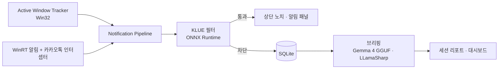

# 🧠 Altong (알통) - ContextPass

> **작업 화면 맥락과 중요도를 실시간 분석하는 지능형 PC 알림 필터링 및 요약 서비스**  
> *AI 서비스 프로젝트 (3학년 2학기 팀 프로젝트)*

작업 중인 창과 알림 내용을 온디바이스 AI로 함께 판단해 필요한 알림만 통과시키고, 나머지는 모아 두었다가 집중이 끝나면 요약해 주는 Windows 앱입니다.

## 왜 만들었나

- Windows 방해 금지 모드는 켜고 끄는 것뿐이라 잡담과 긴급 연락을 구분하지 못합니다.
- 알림으로 흐름이 끊기면 다시 몰입하는 데 평균 23분 15초가 걸립니다(ACM CHI 2005). 그렇다고 전부 끄면 중요한 연락을 놓칠까 불안합니다.
- 알통은 **현재 작업 창과 알림 내용을 함께 보고** 통과·차단을 정하고, 집중이 끝나면 쌓인 알림을 요약해 줍니다.

자세한 배경과 설계 철학: [docs/OVERVIEW.md](docs/OVERVIEW.md)

## 주요 기능

- **자동 집중 모드 (AutoDND)**: 작업 앱 사용을 감지해 집중 모드를 제안하고, 자리비움이 길어지면 세션을 자동으로 종료합니다.
- **맥락 기반 실시간 알림 필터링**: 활성 창(프로세스·제목)과 알림을 KLUE 판별 모델로 함께 평가해 긴급도(1~5)가 4 이상이거나 관련도(1~3)가 3이면 통과시킵니다. 캡처 도구 등 불필요한 시스템 유틸 알림은 수집 단계에서 제외합니다.
- **Windows 10/11 네이티브 알림 제어 · 복구**: 집중 중 선택한 앱의 시스템 알림을 차단하고, 비정상 종료 시에도 복구 가디언이 원래 알림 설정을 되돌립니다.
- **상단 노치 · 알림 패널 · 퀵 메모**: 화면 맨 위 독립 노치에 상태를 표시하고, 마우스를 올리거나 클릭하면 알림 목록과 퀵 메모가 펼쳐집니다.
- **세션 리포트 · 브리핑 · 일정 등록**: 집중을 마치면 로컬 Gemma 4 E2B 모델(Vulkan GPU · CPU 자동 폴백)이 대화별 알림을 요약하고 일정을 추출해 팝업에서 바로 구글 캘린더로 등록합니다.
- **대시보드 · 집중 인사이트**: 홈, 알림 확인, 활동 일지, 집중 인사이트(연속 집중 추이 · 방해 차단율 · 몰입 유지율 · 작업 순도 · 시간대별 패턴 · AI 집중 코칭), 리포트 캘린더, 집중·휴식 루틴 설정을 제공합니다.
- **카카오톡 알림 처리 (선택 연동)**: 개발·선택 환경(`ALTONG_ENABLE_KAKAO=1`)에서 카카오톡 팝업을 숨긴 뒤 온디바이스 PP-OCRv5로 본문을 읽어 같은 방식으로 판단합니다.
- **100% 로컬 실행**: 알림 내용과 창 제목을 외부로 보내지 않습니다. Python 없이 C# 프로세스 안에서 ONNX·GGUF 모델을 실행합니다.

## 구조 한눈에 보기



상세 설계, 데이터 계약, DB 스키마: [docs/ARCHITECTURE.md](docs/ARCHITECTURE.md)

## 기술 스택

| 영역 | 사용 기술 |
| :--- | :--- |
| 플랫폼 | Windows 10 (1809+) / 11, C# 13, .NET 9 (`net9.0-windows10.0.26100.0`) |
| UI | WPF (+ WinForms 트레이) |
| OS 연동 | Win32 `User32`, WinRT `UserNotificationListener`, PP-OCRv5 / Windows OCR |
| 실시간 필터 | KLUE base 판별 모델, `Microsoft.ML.OnnxRuntime` |
| 브리핑 · 코칭 | Gemma 4 E2B (GGUF Q4_0), `LLamaSharp` (CPU, Vulkan GPU) |
| 저장소 | SQLite (`Microsoft.Data.Sqlite`, WAL) |
| 테스트 / CI | MSTest, GitHub Actions (Windows) |

## 시작하기

### 요구사항
* Windows 10 (버전 1809 이상) 또는 Windows 11
* [.NET 9 SDK (x64)](https://dotnet.microsoft.com/download/dotnet/9.0) 설치 필요

### 모델 준비
모델 파일은 Git에 들어 있지 않습니다. 저장소 루트에서 아래 명령을 실행하면 필요한 모델을 받고 해시까지 확인합니다. 이미 맞는 파일은 건너뛰므로, 모델이 바뀌었다는 공지가 오면 pull한 뒤 다시 실행하면 됩니다.

```powershell
powershell -ExecutionPolicy Bypass -File tools/download-models.ps1
```

| 모델 | 위치 | 출처 |
| :--- | :--- | :--- |
| 필터 (KLUE, filtering-v3, 약 440MB) | `models/filtering/klue-base-safety-v1/model-fp32.onnx` | ALTONG_ai 릴리즈 `filtering-v3` |
| 요약 (Gemma 4 E2B Q4_0, 약 2.8GB) | `models/briefing/gemma-4-E2B-it-Q4_0.gguf` | ggml-org [gemma-4-E2B-it-GGUF](https://huggingface.co/ggml-org/gemma-4-E2B-it-GGUF), Apache 2.0 |
| 카카오톡 팝업 OCR (13MB) | `models/ocr/ppocr-v5-ko/korean_PP-OCRv5_mobile_rec.onnx` | PaddlePaddle 공식 [korean_PP-OCRv5_mobile_rec_onnx](https://huggingface.co/PaddlePaddle/korean_PP-OCRv5_mobile_rec_onnx), Apache 2.0 |

- 필터 모델이 `manifest.json`의 해시와 다르면 앱은 필터를 끄고 모든 알림을 통과시킵니다. 화면에는 오류가 보이지 않으니 모델 변경 공지가 오면 꼭 다시 실행하세요.
- 요약 모델이 없으면 AI 요약 대신 기본 요약을 씁니다. OCR 모델이 없으면 Windows OCR로 대신 읽는데, 'ㅋㅋㅋ' 같은 짧은 본문을 읽지 못해 본문이 `(내용을 읽지 못함)`으로 들어옵니다.
- `-CheckOnly`를 붙이면 받지 않고 확인만 합니다. 설치 파일 빌드(`tools/build-installer.ps1`)가 시작할 때 이 확인을 거칩니다.

### 빌드 및 실행

```powershell
# 1. 저장소 복제
git clone https://github.com/AIoish/ALTONG_client.git
cd ALTONG_client

# 2. 전체 솔루션 의존성 복원 및 빌드
dotnet build Altong.Client.sln

# 3. 메인 클라이언트 앱 실행
dotnet run --project src/Altong.Client

# 4. 개발/테스트용 모의 알림 생성기 실행 (선택)
dotnet run --project tools/Altong.MockGenerator

# 5. 단위 테스트 실행
dotnet test
```

상단 노치·알림 패널 사용법과 집중 모드 기록 규칙: [docs/CLIENT_BEHAVIOR.md](docs/CLIENT_BEHAVIOR.md)

문제가 생기면 로그 `%LOCALAPPDATA%\Altong\logs\altong.log`를 확인하세요. 설치본에도 남고, 5MB마다 `altong.1.log`·`altong.2.log`로 밀어내 최대 15MB만 보관합니다. 로그에는 알림 제목·창 제목이 들어가며 이 PC 밖으로 보내지 않습니다. 필터 모델을 불러오지 못하면 시작할 때 트레이 알림으로 알려 줍니다.

### 설치 파일 만들기

.NET이 없는 PC에도 설치할 수 있는 `dist\AltongSetup-<버전>.exe`(모델 3종 포함 약 3GB 이상 — 2GB 초과 시 `packaging/installer/Altong.iss`에 `DiskSpanning=yes` 설정 필요)를 만듭니다.

```powershell
winget install --id JRSoftware.InnoSetup -e   # 처음 한 번
powershell -ExecutionPolicy Bypass -File tools/build-installer.ps1 -Version 1.0.0
```

- 모델 3개와 Windows SDK(makeappx, signtool)가 필요합니다.
- 설치 프로그램은 관리자 권한으로 실행되며, 알림 권한용 패키지 서명 인증서(`CN=AltongDev`, 자체 서명)를 그 PC에 신뢰시키고 패키지를 등록합니다. 제거하면 인증서와 패키지도 지웁니다.
- 서명 인증서는 빌드한 PC의 현재 사용자 인증서 저장소에 있고, 없으면 새로 만듭니다. 저장소에는 넣지 않습니다.
- 설치 파일 자체는 서명하지 않아서, 인터넷으로 받은 PC에서는 SmartScreen 경고가 뜹니다("추가 정보 → 실행").
- 개발 PC에 설치하면 개발용 패키지 등록이 설치본으로 바뀝니다. 다시 개발하려면 `tools/register-sparse-package.ps1`을 실행하세요.

## 프로젝트 구조

```text
ALTONG_client/
├── src/Altong.Client/          # WPF 메인 앱 (Services, Data, Models, 화면)
├── integration/csharp/         # KLUE 필터 추론 라이브러리와 앱 어댑터
├── models/                     # filtering(KLUE ONNX), briefing(Gemma GGUF), ocr — 모델 파일은 gitignore
├── tests/Altong.Client.Tests/  # MSTest 단위·UI·연동 테스트
├── tools/                      # MockGenerator, 패키징·캘린더 테스트 스크립트
├── packaging/                  # Sparse package (알림 권한용)
├── assets/icon/                # 앱·트레이 아이콘 원본 (tools/generate-assets.ps1로 .ico·로고 생성)
├── reports/                    # 필터 모델 평가 보고서
├── docs/                       # 설계·명세·협업 문서
└── Altong.Client.sln
```

## 문서

| 문서 | 내용 |
| :--- | :--- |
| [OVERVIEW](docs/OVERVIEW.md) | 문제 정의, 설계 철학, 학술 연구 근거 |
| [ARCHITECTURE](docs/ARCHITECTURE.md) | 현재 구현 구조, 초기 설계, 데이터 계약, DB 스키마 |
| [AI_MODELS](docs/AI_MODELS.md) | 데이터셋·학습, 모델 변환·연동, 브리핑 개선 계획 |
| [CLIENT_BEHAVIOR](docs/CLIENT_BEHAVIOR.md) | 집중 모드·활동 기록 규칙, 상단 노치·알림 패널 UI |
| [ROADMAP](docs/ROADMAP.md) | 구현 현황, 기능 백로그, 정식 출시 계획 |
| [CONTRIBUTING](docs/CONTRIBUTING.md) | 브랜치·커밋·PR·CI 규칙, 팀 역할 분담 |
| [codex-guidelines](docs/codex-guidelines.md) | AI 코딩 도구 작업 지침 |

## 팀

AIoish 5인 팀: OS 코어·로컬 DB / 실시간 필터 AI / 요약·브리핑 AI / 데스크톱 UI / 대시보드·통합. 역할 상세는 [docs/CONTRIBUTING.md](docs/CONTRIBUTING.md#-8-5인-팀-업무-분장-rr--모듈-인터페이스)를 참고하세요.
