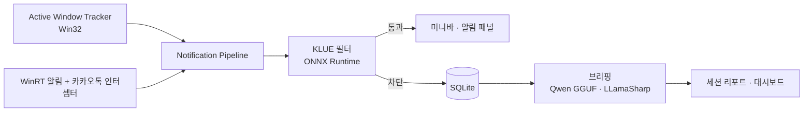

# 🧠 Altong (알통) - ContextPass

> **작업 화면 맥락과 중요도를 실시간 분석하는 지능형 PC 알림 필터링 및 요약 서비스**  
> *AI 서비스 프로젝트 (3학년 2학기 팀 프로젝트)*

작업 중인 창과 알림 내용을 온디바이스 AI로 함께 판단해 필요한 알림만 통과시키고, 나머지는 모아 두었다가 집중이 끝나면 요약해 주는 Windows 앱입니다.

## 왜 만들었나

- Windows 방해 금지 모드는 켜고 끄는 것뿐이라 잡담과 긴급 연락을 구분하지 못합니다.
- 알림으로 흐름이 끊기면 다시 몰입하는 데 평균 23분 15초가 걸립니다(ACM CHI 2005). 그렇다고 전부 끄면 중요한 연락을 놓칠까 불안합니다.
- 알통은 **현재 작업 창과 알림 내용을 함께 보고** 통과·차단을 정하고, 집중이 끝나면 쌓인 알림을 요약해 줍니다.

자세한 배경과 설계 철학: [docs/OVERVIEW.md](docs/OVERVIEW.md)

## 주요 기능

- **맥락 기반 알림 필터링**: 활성 창(프로세스·제목)과 알림을 KLUE 판별 모델로 함께 평가합니다. 긴급도 4 이상이거나 관련도 4 이상이면 통과합니다.
- **카카오톡 알림 처리**: Windows 알림 외에 카카오톡 팝업도 숨긴 뒤 OCR로 내용을 읽어 같은 방식으로 판단합니다.
- **미니바 + 알림 패널**: 작업표시줄 위 작은 캡슐에 상태를 표시하고, 마우스를 올리면 알림 목록이 펼쳐집니다.
- **세션 리포트·브리핑**: 집중을 마치면 로컬 Qwen 모델이 차단된 알림을 요약하고 일정을 뽑습니다. 일정은 구글 캘린더 등록 링크로 연결됩니다.
- **대시보드**: 알림 기록(통과/차단), 시간대별 활동 일지, 앱별 집중 시간, 리포트 캘린더, 집중·휴식 루틴 설정을 제공합니다.
- **로컬 실행**: 알림 내용과 창 제목을 외부로 보내지 않습니다. Python 없이 C# 프로세스 안에서 모델을 실행합니다.

## 구조 한눈에 보기



상세 설계, 데이터 계약, DB 스키마: [docs/ARCHITECTURE.md](docs/ARCHITECTURE.md)

## 기술 스택

| 영역 | 사용 기술 |
| :--- | :--- |
| 플랫폼 | Windows 10 (1809+) / 11, C# 13, .NET 9 (`net9.0-windows10.0.26100.0`) |
| UI | WPF (+ WinForms 트레이) |
| OS 연동 | Win32 `User32`, WinRT `UserNotificationListener`, Windows OCR |
| 실시간 필터 | KLUE base 판별 모델, `Microsoft.ML.OnnxRuntime` |
| 브리핑 | Qwen LoRA (GGUF Q8_0), `LLamaSharp` |
| 저장소 | SQLite (`Microsoft.Data.Sqlite`, WAL) |
| 테스트 / CI | xUnit, GitHub Actions (Windows) |

## 시작하기

### 요구사항
* Windows 10 (버전 1809 이상) 또는 Windows 11
* [.NET 9 SDK (x64)](https://dotnet.microsoft.com/download/dotnet/9.0) 설치 필요

### 모델 준비
- **필터 모델**: `models/filtering/klue-base-safety-v1/`에 들어 있습니다. 빌드할 때 출력 폴더로 복사됩니다.
- **브리핑 모델**: Git에 포함되지 않습니다. GitHub Release `briefing-v8-q8-mvp`에서 `qwen_briefing_v8_q8_0.gguf`를 받아 `models/briefing/`에 넣으세요. 없으면 AI 요약을 쓸 수 없습니다.

### 빌드 및 실행

```powershell
# 1. 저장소 복제
git clone https://github.com/AIoish/ALTONG_client.git
cd ALTONG_client

# 2. 전체 솔루션 의존성 복원 및 빌드
dotnet build Altong.Client.sln

# 3. 메인 클라이언트 앱 실행
dotnet run --project src/Altong.Client

# 4. 개발/테스트용 모의 알림 생성기 실행 (선택)
dotnet run --project tools/Altong.MockGenerator

# 5. 단위 테스트 실행
dotnet test
```

미니바·알림 패널 사용법과 집중 모드 기록 규칙: [docs/CLIENT_BEHAVIOR.md](docs/CLIENT_BEHAVIOR.md)

## 프로젝트 구조

```text
ALTONG_client/
├── src/Altong.Client/          # WPF 메인 앱 (Services, Data, Models, 화면)
├── integration/csharp/         # KLUE 필터 추론 라이브러리와 앱 어댑터
├── models/                     # filtering(KLUE ONNX), briefing(Qwen GGUF, gitignore)
├── tests/Altong.Client.Tests/  # xUnit 테스트
├── tools/                      # MockGenerator, 패키징·캘린더 테스트 스크립트
├── packaging/                  # Sparse package (알림 권한용)
├── reports/                    # 필터 모델 평가 보고서
├── docs/                       # 설계·명세·협업 문서
└── Altong.Client.sln
```

## 문서

| 문서 | 내용 |
| :--- | :--- |
| [OVERVIEW](docs/OVERVIEW.md) | 문제 정의, 설계 철학, 학술 연구 근거 |
| [ARCHITECTURE](docs/ARCHITECTURE.md) | 현재 구현 구조, 초기 설계, 데이터 계약, DB 스키마 |
| [AI_MODELS](docs/AI_MODELS.md) | 데이터셋·학습, 모델 변환·연동, 브리핑 개선 계획 |
| [CLIENT_BEHAVIOR](docs/CLIENT_BEHAVIOR.md) | 집중 모드·활동 기록 규칙, 미니바·알림 패널 UI |
| [ROADMAP](docs/ROADMAP.md) | 구현 현황, 기능 백로그, 정식 출시 계획 |
| [CONTRIBUTING](docs/CONTRIBUTING.md) | 브랜치·커밋·PR·CI 규칙, 팀 역할 분담 |
| [codex-guidelines](docs/codex-guidelines.md) | AI 코딩 도구 작업 지침 |

## 팀

AIoish 5인 팀: OS 코어·로컬 DB / 실시간 필터 AI / 요약·브리핑 AI / 데스크톱 UI / 대시보드·통합. 역할 상세는 [docs/CONTRIBUTING.md](docs/CONTRIBUTING.md#-8-5인-팀-업무-분장-rr--모듈-인터페이스)를 참고하세요.
