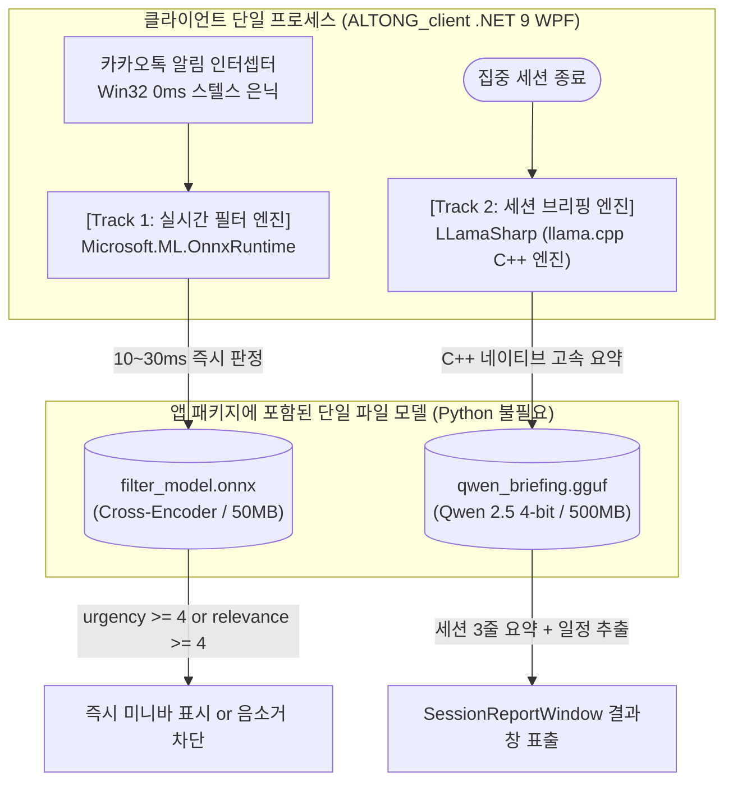
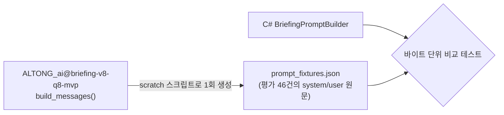

# 🧪 ContextPass AI 모델

> 실시간 필터(Track 1)와 세션 브리핑(Track 2) 모델의 데이터셋, 학습, 앱 연동, 개선 계획을 모은 문서입니다.
> 원래 README §3, `docs/AI_ARCHITECTURE_AND_INTEGRATION_GUIDE.md`, `docs/BRIEFING_HARDENING_PLAN.md`를 합쳤습니다.

## 0. 현재 상태 요약 (develop `682e01e` 기준)

| 트랙 | 모델 | 런타임 | 파일 위치 | 비고 |
| :--- | :--- | :--- | :--- | :--- |
| Track 1 실시간 필터 | KLUE base 안전 보강 판별 모델 (FP32 ONNX, 약 440MB) | `Microsoft.ML.OnnxRuntime` 1.31.0 (`Altong.Filtering`) | `models/filtering/klue-base-safety-v1/` | manifest의 SHA256으로 확인 후 로딩 |
| Track 2 세션 브리핑 | Qwen LoRA 병합 GGUF (`qwen_briefing_v8_q8_0.gguf`) | `LLamaSharp` 0.27.0 (CPU) | `models/briefing/` (gitignore) | GitHub Release `briefing-v8-q8-mvp`에서 받음 |

> [!WARNING]
> 아래 원문 중 현재 구현과 다른 부분:
> - §1(README §3)은 필터에도 Qwen을 쓰려던 초기 계획입니다. 필터는 KLUE 판별 모델로 바뀌었습니다.
> - AI 아키텍처 가이드의 "KLUE-RoBERTa-Small 약 60MB / `filter_model.onnx` 약 50MB / 10~30ms"와 `OnnxFilterEngine` 예시 코드는 계획 단계 내용입니다. 실제 모델은 KLUE base(약 440MB)이고 어댑터는 `KlueFilterEngine`입니다. 지연시간 실측 자료는 아직 없습니다.
> - 브리핑 상용화 계획의 진행 상태는 2026-10-13 기준입니다. 2단계(`SemaphoreSlim` 직렬화, 언로드, 90초 제한, `ContextSize = 4096`)와 3단계는 현재 코드에 아직 반영되지 않았습니다 (`LlamaBriefingEngine`의 `ContextSize = 2048`, 정규식 폴백 유지).

관련 자료:
- 필터 모델 연동 안내: [integration/csharp/README.md](../integration/csharp/README.md)
- 필터 평가 보고서: [safety-model-summary.md](../reports/safety-model-summary.md), [new-holdout-review.md](../reports/new-holdout-review.md)

---

## 🧪 3. 데이터셋 구축 및 경량 SLM 파인튜닝 파이프라인 (AI Modeling)

> 📦 원래 README §3에 있던 내용입니다. 초기 계획입니다.

### 3.1 데이터셋 수집 및 증강 (Dataset Pipeline)
* **3대 핵심 데이터 소스 수집:**
  1. **주요 작업 프로그램 리스트:** 개발 도구(VS Code, 터미널), 사무 툴(Word, Notion), 브라우저 등 대표 작업 맥락(Active Window) 정의
  2. **SNS 대화 코퍼스:** AI Hub 한국어 SNS 대화 데이터셋 및 일상 단톡방 잡담 코퍼스
  3. **업무 및 시스템 알림:** 슬랙/지라/이메일 업무 공지, 민원/상담 긴급도 분류 데이터셋 및 쇼핑몰/앱 푸시 알림
* **합성 데이터셋 구축 (Synthetic Data Augmentation):**
  - 위 3대 소스를 결합하여 `[작업 창 맥락] + [인입 알림] + [긴급도/연관도(1~5)] + [Pass 여부] + [판단 사유]` 구조화 데이터셋 2,500~3,000건 생성 및 검수

### 3.2 경량 SLM LoRA 파인튜닝 (Fine-Tuning)
* **베이스 모델 (Base Model):** `Qwen 2.5 0.5B / 1.5B` 또는 `Llama 3.2 1B`
* **파인튜닝 목적:**
  1. **초저지연(Latency) 보장:** 추론 속도 0.3초 이내 확보 (0.5B~1.5B 극소형 파라미터 최적화)
  2. **100% 구조화 출력(Structured JSON) 강제:** 스키마 에러(환각) 0% 달성
  3. **한국어 메신저/개발자 은어 이해:** 단톡방 축약어, 슬랙 개발 용어(핫픽스, 머지 등)의 맥락 매핑
* **학습 도구:** Google Colab / Unsloth (QLoRA)

### 3.3 정량적 성능 평가 계획 (Benchmark & Ablation Study)
* **평가 지표:** 분류 정확도(Accuracy), Macro F1-Score, 추론 지연시간(Latency, ms), JSON 형식 준수율
* **비교 실험 설계:**
  - `Base SLM (Zero-shot)` vs `Fine-tuned ContextPass-SLM (Ours)` vs `Cloud LLM (GPT-4o-mini / Groq)` 성능 비교 장표 도출

---

## 🧠 ALTONG AI 아키텍처 및 순수 C# 네이티브 연동 가이드

> 📦 원래 `docs/AI_ARCHITECTURE_AND_INTEGRATION_GUIDE.md`에 있던 내용입니다.
> **문서 버전:** 2.0.0 (Zero-Python In-Process Architecture)  
> **최종 수정일:** 2026-10-09  
> **대상:** ALTONG 팀 전체 (클라이언트 & AI 엔지니어)

---

### 📌 1. 개요 및 핵심 딜레마 (Problem Statement)

ALTONG 서비스의 핵심 가치는 **"사용자의 현재 작업 화면 맥락(Active Window)과 수신된 알림의 관계를 AI가 지능적으로 이해하여 선별 노출하는 것"**입니다. 단순 키워드 매칭(룰베이스)으로는 복잡한 작업 맥락을 읽을 수 없으므로 **반드시 딥러닝 AI 모델**이 필요합니다.

그러나 실제 개발 및 검증 과정에서 다음과 같은 치명적인 기술적 딜레마에 직면했습니다:

```
[핵심 딜레마 삼각관계]
1. 초저지연 (Real-time < 30ms) : 알림은 사용자 화면에 즉각 반응해야 함 (스텔스 은닉 후 3초 지연은 사용 불가)
2. 깊은 맥락 이해 (Semantic Context): 룰베이스가 아닌 트랜스포머의 Attention 연산이 필수적임
3. 온디바이스 개인정보 보호        : 카카오톡 메시지와 활성 창 제목은 외부 클라우드 API로 전송 불가
```

| 접근 방식 | 맥락 이해도 | 반응 속도 (Latency) | 보안 및 개인정보 | 런타임 배포성 |
| :--- | :---: | :---: | :---: | :---: |
| **단순 룰베이스 (키워드 매칭)** | ❌ 전무 (오판 빈번) | 🟢 0.001초 | 🟢 안전 | 프로젝트 취지에 어긋남 (탈락) |
| **외부 클라우드 API (Jev, GPT 등)** | 🟢 우수 | 🟡 0.2~0.5초 (네트워크 RTT) | ❌ **치명적 (카톡/화면 유출)** | 상용 배포 불가 (탈락) |
| **기존 생성형 SLM (Qwen LoRA)** | 🟢 우수 | ❌ **3.0초 ~ 7.8초 (실측)** | 🟢 안전 | 알림 반응 딜레이 발생 (실시간 불가) |
| **💡 순수 C# 네이티브 인프로세스 AI** | 🟢 **우수 (Attention 탑재)** | 🟢 **0.01초 ~ 0.03초 (10~30ms)** | 🟢 **100% 로컬 격리** | **Python 설치 불필요 (단일 바이너리)** |

---

### ⏱️ 2. 왜 생성형 LLM(Qwen)은 숫자 2개만 뽑아도 3초가 걸리는가?

AI 파트에서 점수(`urgency`, `relevance`)만 출력하도록 프롬프트를 줄였음에도 외장 GPU(RTX 3060) 환경에서 약 3초가 소요되는 이유는 **생성형 모델(Causal LM)의 태생적 물리 한계** 때문입니다:

1. **긴 프롬프트 프리필 (Pre-fill Overhead, ~0.8s)**:
   * 시스템 프롬프트 + 카톡 알림 내용 + 활성 창 맥락을 합치면 **300~500 토큰**입니다.
   * 4-bit 양자화(NF4)는 메모리를 아끼지만, 매번 4-bit 가중치를 실시간 복원(Dequantize)하며 순회하므로 프롬프트를 1회 훑는 데만 0.5~1초가 듭니다.
2. **오토리그레시브 디코딩 루프 (Decoding Loop, ~1.5s)**:
   * 사람 눈에는 숫자 2개 같지만, JSON 형식을 맞추기 위해 `{`, `"`, `urgency`, `":`, `3`, `,` ... 등 **최소 15~20회의 반복 순회(루프)**를 돕니다.
   * 토큰을 1개 찍을 때마다 6억 개(0.6B) 파라미터 신경망을 처음부터 끝까지 다시 통과해야 합니다.
3. **파이썬 인터프리터 오버헤드 (~0.5s)**:
   * C++ 컴파일 바이너리가 아닌 파이썬 런타임에서 텐서 할당 및 토크나이저 변환 오버헤드가 발생합니다. (외장 GPU가 없는 일반 노트북 CPU에서는 8~15초로 폭증)

---

### 🎯 3. 최종 확정 아키텍처: 순수 C# 네이티브 인프로세스 (Zero-Python)

임시 백그라운드 파이썬 서버(FastAPI)와 같은 기술 부채를 완전히 배제하고, **처음부터 C# .NET 9 WPF 단일 프로세스 안에서 모든 AI를 100% C++ 네이티브 속도로 인메모리 구동**합니다.



#### 1) [Track 1] 실시간 알림 필터링 AI (이시영 파트)
* **역할**: 알림 인입 즉시 화면 통과/차단 여부를 0.02초 만에 결정.
* **아키텍처**: **문장 쌍 판별 모델 (Sentence-Pair Cross-Encoder / Jev 스타일)**
  * 베이스 모델: `KLUE-RoBERTa-Small` (약 60MB) 또는 초경량 판별 모델.
  * 원리: `[CLS] 작업 맥락 [SEP] 카카오톡 알림 [SEP]` 형태로 입력 후, **단어 작문 루프 없이 단 1번의 순전파(Single Forward Pass)**로 `[긴급도, 연관도]` 점수 벡터 산출.
  * 트랜스포머 Attention 레이어가 작업과 알림 간의 의미적 맥락(Semantic Context)을 완벽히 계산.
* **지연 시간**: **0.01초 ~ 0.03초 (10~30ms)**.
* **파일 형식**: 단일 **`filter_model.onnx` (약 50MB)**.
* **C# 런타임**: `Microsoft.ML.OnnxRuntime` (공식 마이크로소프트 C++ 네이티브 바인딩).

#### 2) [Track 2] 세션 브리핑 요약 & 일정 추출 AI (박민준 파트)
* **역할**: 집중 세션 종료 시 차단된 알림들을 묶어 3줄 핵심 요약 및 캘린더 일정(시작~종료 시각) 자동 추출.
* **아키텍처**: **생성형 SLM (Qwen 2.5 LoRA 파인튜닝)**
  * 박민준 님이 학습시킨 Qwen 어댑터와 베이스 모델을 하나로 합친 뒤 GGUF 포맷으로 변환.
  * 세션 종료 직후 1회만 호출되므로 3~5초의 생성 시간은 사용자 UX상 전혀 문제가 되지 않음 ("세션 분석 중..." 스피너 표출).
* **파일 형식**: 단일 **`qwen_briefing.gguf` (4-bit 양자화, 약 500MB)**.
* **C# 런타임**: `LLamaSharp` (`llama.cpp` 공식 C# 인메모리 바인딩).

---

### 🛠️ 4. AI 파트 모델 파일 변환 가이드 (AI 엔지니어용)

AI 팀원들은 복잡한 파이썬 서버나 통신 코드를 짤 필요 없이, **학습된 가중치를 단일 파일 1개씩으로 내보내어 C# 팀에 전달**하기만 하면 됩니다.

#### ① 이시영 님 (실시간 필터링 모델 ➜ ONNX 변환)
현재 구축된 v3 데이터셋으로 판별 모델을 학습한 후, 파이썬에서 한 줄로 내보냅니다:
```python
# export_onnx.py
import torch

model.eval()
dummy_input = torch.randint(0, 1000, (1, 128)) # [batch, seq_len]

torch.onnx.export(
    model,
    dummy_input,
    "filter_model.onnx",
    input_names=["input_ids"],
    output_names=["scores"], # [urgency, relevance]
    dynamic_axes={"input_ids": {0: "batch", 1: "sequence"}}
)
print("filter_model.onnx 생성 완료 (약 50MB)")
```

#### ② 박민준 님 (브리핑 Qwen LoRA ➜ GGUF 변환)
학습된 LoRA 가중치를 원본 모델과 병합한 뒤, `llama.cpp` 공식 스크립트로 1분 만에 변환합니다:
```python
# 1. LoRA 가중치 병합 (merge.py)
from peft import PeftModel
from transformers import AutoModelForCausalLM, AutoTokenizer

base = AutoModelForCausalLM.from_pretrained("Qwen/Qwen2.5-0.5B-Instruct")
model = PeftModel.from_pretrained(base, "outputs/briefing-qwen-lora")
merged = model.merge_and_unload()
merged.save_pretrained("./qwen_merged")
```
```bash
# 2. GGUF 단일 파일 변환 (터미널)
git clone https://github.com/ggerganov/llama.cpp
python llama.cpp/convert_hf_to_gguf.py ./qwen_merged --outfile qwen_briefing.gguf --outtype q4_k_m
# -> qwen_briefing.gguf 생성 완료 (약 400~500MB)
```

---

### 💻 5. C# WPF 클라이언트 구현 코드 (클라이언트 엔지니어용)

#### 1) NuGet 패키지 설치
`Altong.Client.csproj`에 아래 네이티브 고속 런타임 패키지를 추가합니다:
```shell
dotnet add package Microsoft.ML.OnnxRuntime
dotnet add package LLamaSharp
dotnet add package LLamaSharp.Backend.Cpu
# (선택: 외장 엔비디아 GPU 탑재 PC 가속용)
# dotnet add package LLamaSharp.Backend.Cuda12
```

#### 2) [Track 1] C# 실시간 필터 엔진 (`OnnxFilterEngine.cs`)
```csharp
using Microsoft.ML.OnnxRuntime;
using Microsoft.ML.OnnxRuntime.Tensors;
using Altong.Client.Models;

namespace Altong.Client.Services.Notifications;

public sealed class OnnxFilterEngine : IFilterEngine, IDisposable
{
    private readonly InferenceSession _session;

    public OnnxFilterEngine(string modelPath = "models/filter_model.onnx")
    {
        var options = new SessionOptions();
        options.AppendExecutionProvider_CPU(); // 10ms CPU 초고속 실행
        _session = new InferenceSession(modelPath, options);
    }

    public Task<FilterResult> EvaluateAsync(RawNotification notification, CurrentContext context)
    {
        // 1. 작업 맥락과 알림 텍스트 결합 토큰화 (전처리)
        DenseTensor<long> inputTensor = CreateInputTensor(notification, context);

        // 2. 단 1번의 순전파 실행 (10~20ms 소요, 단어 작문 루프 없음)
        using var results = _session.Run(new[] { NamedOnnxValue.CreateFromTensor("input_ids", inputTensor) });
        
        // 3. 점수 추출 (urgency, relevance)
        var scores = results.First().AsTensor<float>().ToArray();
        float urgency = scores[0];
        float relevance = scores[1];

        bool isPassed = (urgency >= 4.0f || relevance >= 4.0f);

        return Task.FromResult(new FilterResult(
            notification.Id,
            IsPassed: isPassed,
            UrgencyScore: (int)Math.Round(urgency),
            RelevanceScore: (int)Math.Round(relevance),
            Category: "업무 연관",
            AiSummaryReason: "온디바이스 판별 트랜스포머 모델에 의한 실시간 맥락 일치 판정"
        ));
    }

    private DenseTensor<long> CreateInputTensor(RawNotification n, CurrentContext c)
    {
        // 간단한 토큰화 또는 사전 구축된 인덱스 변환 로직
        var dimensions = new[] { 1, 128 };
        return new DenseTensor<long>(dimensions);
    }

    public void Dispose() => _session.Dispose();
}
```

#### 3) [Track 2] C# 세션 브리핑 서비스 (`LlamaBriefingService.cs`)
```csharp
using System.Text;
using LLama;
using LLama.Common;
using Altong.Client.Models;

namespace Altong.Client.Services.Briefing;

public sealed class LlamaBriefingService : IDisposable
{
    private readonly LLamaWeights _weights;
    private readonly ModelParams _parameters;

    public LlamaBriefingService(string modelPath = "models/qwen_briefing.gguf")
    {
        _parameters = new ModelParams(modelPath)
        {
            ContextSize = 2048,
            GpuLayerCount = 20 // 외장 GPU 존재 시 자동 GPU 오프로딩, 없을 시 0으로 CPU 구동
        };
        _weights = LLamaWeights.LoadFromFile(_parameters);
    }

    public async Task<string> GenerateSessionBriefingAsync(List<NotificationRecord> blockedNotifications)
    {
        using var context = _weights.CreateContext(_parameters);
        var executor = new InteractiveExecutor(context);
        
        var chatHistory = new ChatHistory();
        chatHistory.AddMessage(AuthorRole.System, "당신은 알림 요약 비서입니다. 차단된 알림 목록을 보고 핵심 3줄 요약과 추출된 일정을 JSON 형식으로 작성하세요.");
        
        string userPrompt = FormatNotificationsForPrompt(blockedNotifications);
        var session = new ChatSession(executor, chatHistory);

        var resultBuilder = new StringBuilder();
        await foreach (var token in session.ChatAsync(new ChatHistory.Message(AuthorRole.User, userPrompt)))
        {
            resultBuilder.Append(token);
        }

        return resultBuilder.ToString();
    }

    private string FormatNotificationsForPrompt(List<NotificationRecord> items)
    {
        var sb = new StringBuilder();
        foreach (var item in items)
        {
            sb.AppendLine($"- [{item.AppName}] {item.Sender}: {item.Body}");
        }
        return sb.ToString();
    }

    public void Dispose() => _weights.Dispose();
}
```

---

### 📋 6. 팀원별 차주 액션 아이템 (Action Items)

| 담당자 | 파트 | 핵심 액션 아이템 |
| :--- | :---: | :--- |
| **이시영** | 실시간 필터 AI | • v3 데이터셋을 판별형 트랜스포머 모델로 학습<br/>• 학습 완료 후 `export_onnx.py`로 `filter_model.onnx` 파일 생성하여 C# 팀 전달 |
| **박민준** | 세션 브리핑 AI | • Qwen 2.5 LoRA 가중치 병합(`merge.py`) 및 `convert_hf_to_gguf.py` 실행<br/>• `qwen_briefing.gguf` 파일 생성하여 C# 팀 전달 |
| **김동준** | OS 코어 & 연동 | • C# 프로젝트에 `Microsoft.ML.OnnxRuntime` 및 `LLamaSharp` 패키지 추가<br/>• `OnnxFilterEngine.cs` 및 `LlamaBriefingService.cs` 연동 파이프라인 완성 |
| **강민교** | 클라이언트 UI | • 20ms 즉시 판정 신호에 맞춰 미니바 독 실시간 애니메이션 연동 |
| **이현우** | 대시보드 UI | • `SessionReportWindow`에 C# 브리핑 엔진이 반환한 JSON 요약문 및 일정 바인딩 |

---

### 🏆 7. 보고서 및 최종 발표 시 핵심 어필 포인트 (Defense & Narrative)

1. **상용급 소프트웨어 완성도 (Zero-Python 배포)**:
   * 일반 사용자에게 Python, PyTorch, CUDA를 설치하게 하는 조잡한 방식을 완전히 탈피함.
   * **C# .NET 9 WPF 단일 실행 파일과 초경량 모델 파일만으로 구성된 완벽한 온디바이스 단일 아키텍처**를 달성함.
2. **보안 및 프라이버시 100% 보장**:
   * 카톡 메시지와 작업 화면 정보가 컴퓨터 외부로 1바이트도 유출되지 않음 (비행기 모드에서도 완벽 작동).
3. **공학적 트러블슈팅과 성능 혁신**:
   * 생성형 LLM의 8초 지연 한계를 실측 데이터로 규명하고, **판별형 ONNX(0.02초)와 사후 GGUF 브리핑으로 역할을 정밀 분리**하여 실시간성과 요약 품질을 모두 극대화함.

---

## 🛠️ Track 2 (Qwen 브리핑) 상용화 수정 계획

> 📦 원래 `docs/BRIEFING_HARDENING_PLAN.md`에 있던 내용입니다.

> ### 📌 현재 진행 상황 (2026-10-13 기준)
> - **1단계 (P0): 완료 (229/229 테스트 통과) ✅**
>   - `BriefingPromptBuilder.cs` 구현 및 38개 fixture 바이트 일치 테스트 통과
>   - `LlamaBriefingEngine.cs` ChatML 직접 조립 및 Greedy 디코딩(temp 0) 적용
>   - `App.xaml.cs` 대시보드 LLM 재추론 제거 (`summaryProvider: null`)
>   - 결정적 ID(SHA256) 생성 및 세션별 태스크 캐시 적용
> - **2단계 (P1 - 안정성): 다음 작업 대기 ⏳**
>   - 추론 완료 후 메모리 언로드, SemaphoreSlim(1) 직렬화, CPU 스레드 수 제한, 90초 타임아웃
> - **3단계 (P1 - 일정 추출기): 대기 ⏳**
>
> ⚠️ **노트북 이전 시 주의사항:**
> `models/briefing/qwen_briefing_v8_q8_0.gguf` 모델 파일은 `.gitignore` 대상이므로 Git으로 넘어가지 않습니다.  
> 노트북에서 `git pull` 후 `models/briefing/` 폴더에 모델 파일을 수동 복사하거나 GitHub Release(`briefing-v8-q8-mvp`)에서 다운로드해 넣어야 실 모델 테스트가 동작합니다.

### 목표
[검토 리포트](file:///C:/Users/kdjkd/.gemini/antigravity-ide/brain/ba8cbeb4-dcb4-4f3c-9cd7-08c7ad59d1f9/ai_integration_review.md)에서 찾은 P0·P1 이슈를 고칩니다. **각 단계는 따로 끝낼 수 있고**, 단계가 끝날 때마다 `dotnet build`와 `dotnet test`가 통과해야 다음으로 넘어갑니다.

| 단계 | 범위 | 상태 | 예상 작업량 |
| :--- | :--- | :---: | :--- |
| **1단계 (P0)** | 프롬프트를 학습 원본과 일치, 대시보드 재추론 제거, 결정적 ID | **완료 ✅** | 가장 큼, 효과도 가장 큼 |
| **2단계 (P1)** | 메모리 해제, 추론 직렬화, 스레드 수와 시간 제한, 엄격한 파싱 | **대기 ⏳** | 중간 |
| **3단계 (P1)** | 일정 추출기 버그 | **대기 ⏳** | 작음 |

**이번 범위에서 제외:** P2 항목(모델 다운로드·해시 확인, NOTICE 파일, 별도 프로세스 분리, KLUE INT8, 저사양 PC 측정)

---

### Open Questions

> [!IMPORTANT]
> **Q1. 대시보드에서 LLM 호출을 빼도 될까요?**
> AI 요약은 세션이 끝날 때 리포트 창에서 **한 번만** 만들고, 대시보드는 **저장된 요약만** 보여주는 방식을 제안합니다. 이렇게 하면 리포트를 저장하지 않고 닫은 세션은 대시보드에 AI 요약이 나오지 않습니다. 저장하지 않으면 리포트 자체가 남지 않는 기존 정책과 같은 동작입니다.

> [!NOTE]
> **Q2. 46건 결과 비교는 Python 출력 없이 시작합니다.** AI 팀 저장소의 `build_messages()`를 제가 직접 실행해서 **기대 프롬프트 fixture**를 만들고, C#이 만든 프롬프트가 그와 바이트 단위로 같은지 확인합니다. 모델 품질(카테고리 일치율)은 실제 모델로 46건을 돌려 측정하는 선택 실행 테스트로 확인합니다. 박민준 님의 Python 출력을 받으면 나중에 결과 비교로 강화하면 됩니다.

---

### 1단계 — P0

#### 1-A. 프롬프트·템플릿을 학습 원본과 일치



##### [NEW] `Services/AI/Briefing/BriefingPromptBuilder.cs`
- `SYSTEM_PROMPT`의 규칙 1~15번과 `CATEGORY_GUIDE`를 원본 문자열 그대로 옮깁니다. Python의 `split("출력 스키마:")`와 12번 규칙 교체 로직도 그대로 재현합니다.
- 입력 JSON을 `{app_name, sender, notifications_oldest_to_newest:[{timestamp,title,body}]}` 구조로 만듭니다. 구분자는 `separators=(",",":")`, `ensure_ascii=False`와 같게 맞춥니다.
- `app_identity()`를 이식합니다(구현 시 `clustering.py`에서 확인).
- user 메시지 문구도 `category_prompt.build_messages`와 똑같이 맞춥니다.

##### [MODIFY] [LlamaBriefingEngine.cs](file:///c:/Users/kdjkd/Desktop/ALTONG_client/src/Altong.Client/Services/AI/Briefing/LlamaBriefingEngine.cs)
- `ChatSession`과 `InteractiveExecutor`를 빼고 **`StatelessExecutor`에 ChatML을 직접 조립**해서 넣습니다.
  ```text
  <|im_start|>system\n{system}<|im_end|>\n<|im_start|>user\n{user}<|im_end|>\n<|im_start|>assistant\n{생각 모드 접두어: 학습 스크립트 기준}
  ```
- Qwen3 생각 모드 처리(빈 `<think></think>`를 넣을지)는 `prepare_category_dataset.py` 또는 학습 스크립트의 `apply_chat_template` 인자를 보고 정합니다.
- `AntiPrompts = ["<|im_end|>"]`, 그리고 원본처럼 `MaxTokens = 256`으로 둡니다.
- 생성 결과가 바뀌지 않도록 **greedy 디코딩(temperature 0)**을 씁니다.

##### [NEW] `tests/.../Fixtures/briefing_prompt_fixtures.json` + `BriefingPromptParityTests.cs`
- scratch Python 스크립트(아티팩트 폴더의 `scratch/`, 저장소에는 넣지 않음)로 `evaluation_cases.jsonl` 46건의 프롬프트를 덤프합니다.
- C# 테스트에서 46건이 모두 같은지 확인합니다.

#### 1-B. 대시보드 재추론 제거, 결정적 ID, 캐시

##### [MODIFY] [App.xaml.cs](file:///c:/Users/kdjkd/Desktop/ALTONG_client/src/Altong.Client/App.xaml.cs)
```diff
-                    RequestShutdown,
-                    summaryProvider: _reportSummaryProvider);
+                    RequestShutdown);   // 대시보드는 저장된 SummaryItems만 사용
```

##### [MODIFY] [LlamaReportSummaryProvider.cs](file:///c:/Users/kdjkd/Desktop/ALTONG_client/src/Altong.Client/Services/AI/Briefing/LlamaReportSummaryProvider.cs)
- **결정적 ID:** `SummaryId = "sum-" + sha256(sessionId|groupKey|정렬된 알림 ID)[..12]`, `EventId`도 같은 방식으로 만듭니다.
- **세션별 메모리 캐시:** `ConcurrentDictionary<sessionId, Task<ReportSummarySupply>>`로 같은 세션을 다시 추론하지 않습니다.

---

### 2단계 — P1 (안정성)

##### [MODIFY] `LlamaBriefingEngine.cs` / `LlamaReportSummaryProvider.cs`
| 이슈 | 변경 |
| :--- | :--- |
| 메모리 상주 | `ReadAsync`가 끝나면 `finally`에서 `engine.Unload()`를 호출해 가중치를 해제합니다 |
| 동시 실행 | 공급자 단위 `SemaphoreSlim(1)`로 세션 브리핑을 한 번에 하나만 실행합니다 |
| 해제 경합 | `Dispose()`는 세마포어를 얻은 다음, 즉 진행 중인 추론이 끝난 다음에 해제합니다 |
| CPU 점유 | `Threads = Max(1, ProcessorCount/2)`. 추론 스레드는 `BelowNormal` 우선순위 |
| 시간 제한 | 세션 전체에 90초 제한(linked CTS). 시간이 넘으면 남은 그룹은 폴백 처리 |
| 컨텍스트 | `ContextSize = 4096`. 그룹당 최근 알림 20건까지만 넣고, 프롬프트 토큰 수가 예산을 넘으면 오래된 알림부터 제거 |
| 엄격한 파싱 | Python `parse_response`와 똑같이 적용합니다. 키는 정확히 2개, 카테고리는 허용된 8개 값, 줄은 1~3개, 줄 길이 제한(`MAX_LINE_LENGTH`). 정규식으로 끌어모으던 복구 로직은 **삭제** |
| 폴백 표시 | 파싱에 실패하면 `"(AI 요약 실패) 발신자: 원문"`처럼 AI 결과가 아님을 표시 |

---

### 3단계 — 일정 추출기 ([BriefingScheduleExtractor.cs](file:///c:/Users/kdjkd/Desktop/ALTONG_client/src/Altong.Client/Services/AI/Briefing/BriefingScheduleExtractor.cs))

| 버그 | 수정 |
| :--- | :--- |
| PC 시간대가 KST가 아니면 예외 발생 | `DateTime.SpecifyKind(…, Unspecified)`로 바꾼 뒤 +09:00 적용. 기준 시각은 KST로 변환해서 사용 |
| "3시"를 03:00으로 처리 | `action_items.py`의 규칙을 그대로 따름(원본을 확인한 뒤 같은 동작으로) |
| 시간 범위에 오전/오후 미적용 | 범위 앞의 오전/오후를 시작·끝 시각 모두에 적용. 끝 시각이 시작보다 이르면 +12시간 |
| 연도 넘김 | 명시한 월·일이 기준 시각보다 60일 넘게 과거면 다음 해로 처리 |
| 원본과 다른 동작 | 원본 `test_category_briefing.py`의 일정 사례 중 핵심 몇 건을 C# 테스트로 이식 |

---

### Verification Plan

#### Automated Tests
```shell
dotnet build
dotnet test                                                     # 기존 218개 + 새 테스트 전체 통과
dotnet test --filter "FullyQualifiedName~BriefingPromptParity"  # 프롬프트 46건 일치
dotnet test --filter "TestCategory=RealModel"                   # 선택 실행: 실제 모델로 46건 카테고리 일치율 출력
```
- 기존 `RealModelInference` 테스트는 **엄격한 파싱이 성공해야 통과**하도록 고칩니다. 지금처럼 폴백 결과로 통과하는 것은 막습니다.
- 1단계를 마치면 릴리즈 평가 수치(카테고리 교정 전 기준)와 크게 차이 나는지 비교해서 보고합니다.

#### Manual Verification
- 집중 세션 종료 → 리포트 창에 AI 요약 표시 → 저장 → 대시보드를 열어도 **CPU 사용이 튀지 않고**, 숨김·저장 상태가 유지되는지 확인
- 브리핑 후 1~2분이 지나면 작업 관리자에서 메모리가 다시 내려가는지 확인
