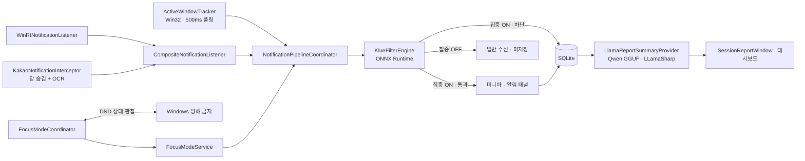
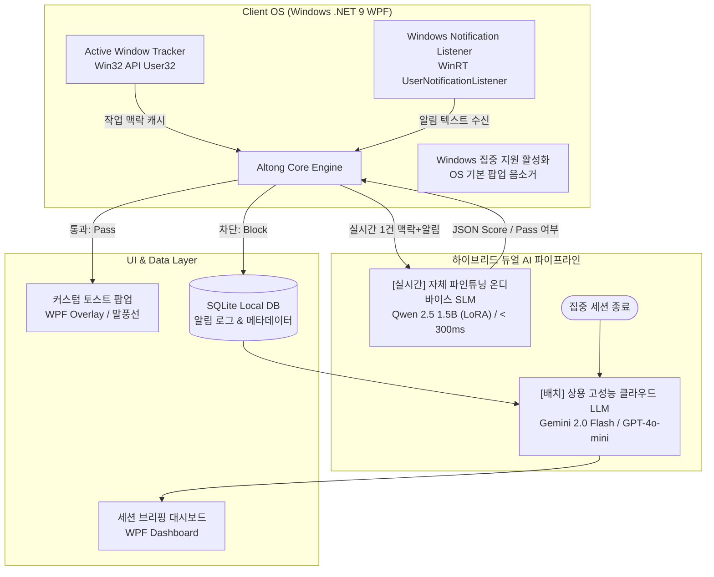

# ⚙️ ContextPass 시스템 아키텍처

> 시스템 구조, 기술 스택, 디렉토리, 모듈 간 데이터 계약을 모은 문서입니다.
> 원래 README §2·§4·§6·§7을 옮겼고, 실제 코드를 기준으로 쓴 "현재 구현 구조"를 앞에 덧붙였습니다.

## 0. 현재 구현 구조 (develop `682e01e` 기준)

> [!IMPORTANT]
> §2 이후의 README 원문은 초기 설계입니다. 실제 코드와 다른 부분은 이 섹션이 우선합니다.

### 0.1 초기 설계와 달라진 점

| 항목 | 초기 설계 (README 원문) | 현재 구현 | 코드 위치 |
| :--- | :--- | :--- | :--- |
| 실시간 필터 모델 | Qwen 2.5 1.5B LoRA SLM, 300ms 미만 | KLUE base 판별 모델 (ONNX FP32, 약 440MB), `Microsoft.ML.OnnxRuntime` 1.31.0 | `integration/csharp/Altong.Filtering`, `integration/csharp/ClientAdapter/KlueFilterEngine.cs` |
| 통과 규칙 | 긴급도 1순위 → 보통이면 연관도 2순위 | 한 번의 추론으로 두 점수를 낸 뒤 `urgency >= 4 OR relevance >= 4`면 통과 | `KlueFilter.cs` |
| 모델 실패 시 | (언급 없음) | 로딩 실패·2초 시간 초과 시 알림을 통과시킴 (fail-open, 점수 0 = 미평가) | `KlueFilterEngine.cs` |
| 필터 결과 `category` | "긴급 업무" 등 분류 | 항상 `"미분류"` 또는 `"판정 실패"` | `KlueFilterEngine.cs` |
| 요약·브리핑 모델 | 클라우드 LLM (Gemini 2.0 Flash / GPT-4o-mini) | 로컬 Qwen GGUF (`qwen_briefing_v8_q8_0.gguf`), `LLamaSharp` 0.27.0. 클라우드 호출 없음 | `Services/AI/Briefing/` |
| 알림 수집 | WinRT `UserNotificationListener` | WinRT + 카카오톡 인터셉터(Win32 창 숨김 + Windows OCR, 2.5배 업스케일)를 `CompositeNotificationListener`로 결합. Mock용 `LocalPipeNotificationListener` 별도 | `Services/Notifications/` |
| Windows 방해 금지 | 집중 시작 시 앱이 켬 | 앱이 직접 켜지 않음. 설정 화면을 열어 안내하고, 관찰한 DND 상태를 앱 상태에 반영 | `FocusModeCoordinator.cs`, `WindowsNotificationModeObserver.cs` |
| 집중 OFF일 때 | (언급 없음) | 필터는 실행하지만 `IsPassed = null`, DB에 저장하지 않음 | `NotificationPipelineCoordinator.cs` |
| 활성 창 추적 | 2초 폴링 + 5초 안정화 룰 | `PeriodicTimer` 500ms 폴링, 안정화 기준 1초, 관측 공백 10초 초과 시 제외, 최근 프로세스 3개 | `ActiveWindowTracker.cs` |
| 통과 알림 표시 | 커스텀 토스트 팝업 | 작업표시줄 위 미니바 + 알림 패널/플라이아웃 | `NotificationDockWindow`, `NotificationFlyoutWindow` |
| 대상 프레임워크 | `net9.0-windows` | `net9.0-windows10.0.26100.0`, WPF + WinForms(트레이) | `Altong.Client.csproj` |

### 0.2 현재 처리 흐름



### 0.3 로컬 SQLite 스키마 (`Data/SqliteDatabase.cs`)

위치: `%LocalAppData%/Altong/altong.db` (WAL 모드)

| 테이블 | 주요 컬럼 | 용도 |
| :--- | :--- | :--- |
| `notifications` | `id, app_name, sender, title, body, received_at, is_passed, urgency_score, relevance_score, category, ai_summary_reason, session_id` | 알림과 필터 판정 결과 |
| `dashboard_notification_dismissals` | `notification_id, dismissed_at` | 대시보드 목록에서 제거한 알림 (원본은 유지) |
| `window_sessions` | `process_name, window_title, started_at, ended_at, duration_seconds, session_id` | 활성 창 체류 기록 |
| `focus_sessions` | `session_id, started_at, ended_at, target_duration_minutes, blocked_count, is_completed` | 집중 세션 메타데이터 |
| `focus_session_reports` | `session_id, started_at, ended_at, saved_at, schema_version, snapshot_json` | 저장한 세션 리포트 스냅샷 |
| `user_feedbacks` | `notification_id, feedback_type, created_at` | 피드백 루프용 (테이블만 있고 UI·반영 로직은 미구현) |

---

## ⚙️ 2. 핵심 동작 메커니즘 & 시스템 아키텍처

> 📦 원래 README §2에 있던 내용입니다. 초기 설계이므로 §0과 함께 보세요.



### 2.1 상세 워크플로우
1. **집중 세션 시작 (간편한 On/Off):** 복잡한 설정 없이 원클릭으로 집중 모드를 활성화하고 Windows '방해 금지/집중 지원' 켬.
2. **작업 맥락 캡처:** 현재 최상단 활성 창(Active Window)의 프로세스명과 윈도우 타이틀을 저비용 Win32 API로 실시간 캐싱.
3. **알림 후킹 및 무음화:** 백그라운드 리스너(`Windows.UI.Notifications.Management.UserNotificationListener`)가 신규 알림 수신 (OS 기본 토스트는 무음화).
4. **2단계 실시간 교차 판별 (< 300ms):**
   - **1단계 (긴급도 채점):** 최고 긴급 알림(서버 장애, 필수 공지 등)은 즉각 통과(Pass).
   - **2단계 (연관도 분석):** 보통 긴급 알림은 현재 작업 맥락(코딩, 문서 작성 등)과의 관련성을 비교 채점하여 통과/차단 결정.
5. **선별적 노출 & 무자극 적재:**
   - **통과(Pass):** 최고 긴급 건만 경량 커스텀 팝업/말풍선으로 즉시 노출.
   - **차단(Mute):** 로컬 SQLite에 무음 적재 및 시스템 트레이 배지 카운터 증가(`🛡️ +1`), 화면 하단 호버링으로 상태 전달.
6. **세션 종료 & 스마트 브리핑 및 피드백 반영:**
   - 고성능 LLM이 부재중 알림 카테고리 요약, 원클릭 스마트 답장 초안, 캘린더 등록 및 업무 일지(TIL) 마크다운 생성.
   - 대시보드에서 알림 선별 결과를 사용자가 평가하고, 이 피드백을 향후 판별 기준으로 지속 반영.

---

## 🛠️ 4. 기술 스택 및 환경

> 📦 원래 README §4에 있던 내용입니다. 현재 버전은 [README](../README.md#기술-스택)를 참고하세요.

| 레이어 | 기술 스택 | 설명 및 선정 이유 |
| :--- | :--- | :--- |
| **OS 타깃** | **Windows 10 / 11** | WinRT API 및 Win32를 통한 시스템 알림/활성 창 수신 |
| **클라이언트 플랫폼** | **C# 13 / .NET 9 (`net9.0-windows`)** | 최신 .NET 9 기반 고성능 데스크톱 앱 개발 |
| **데스크톱 GUI** | **WPF (Windows Presentation Foundation)** | 트레이 상주, 다이내믹 HUD 및 커스텀 토스트 오버레이 |
| **알림 리스너** | **WinRT (`UserNotificationListener`)** | Windows 공식 알림 수신 API |
| **맥락 캡처** | **Win32 API (`User32.dll`)** | `GetForegroundWindow`, 창 제목 및 프로세스 저비용 추적 |
| **실시간 필터 AI** | **자체 파인튜닝 로컬 SLM (Qwen 2.5 1.5B)** | **0.3초 이내 초저지연**, 온디바이스 개인정보 보호, 100% JSON 스키마 |
| **요약/브리핑 AI** | **상용 클라우드 LLM (Gemini 2.0 Flash / GPT-4o-mini)** | 수십 개 알림 묶음의 고차원 문맥 이해, 마크다운 TIL 자동 생성 |
| **데이터베이스** | **SQLite** (로컬 파일 기반) | 네트워크 의존성 없는 빠른 쓰기, 세션 및 알림 로컬 보관 |
| **보조 도구 / 테스트** | **Altong.MockGenerator, xUnit** | 가상 Windows 토스트 발송 도구 및 테스트 |

---

## 📁 6. 프로젝트 디렉토리 구조

> 📦 원래 README §6에 있던 내용입니다. 작성 당시의 구조입니다. 현재 구조는 [README](../README.md#프로젝트-구조)를 참고하세요.

```text
ALTONG_client/
├── src/
│   └── Altong.Client/              # [메인] C# .NET 9 WPF 데스크톱 클라이언트
│       ├── Models/                 # 공통 데이터 계약 모델 (RawNotification, CurrentContext 등)
│       ├── App.xaml / MainWindow.xaml
│       └── Altong.Client.csproj
├── tools/
│   └── Altong.MockGenerator/       # [도구] 모의 알림 발생 도구 (테스트/실험용 WPF 앱)
│       ├── NotificationPresets.cs  # 테스트 알림 템플릿 프리셋
│       └── README.md               # 도구 사용법 및 연동 가이드
├── tests/
│   └── Altong.Client.Tests/        # [테스트] 단위 및 통합 테스트 프로젝트
├── docs/                           # [문서] 협업 가이드, 학술 레퍼런스, 기능 백로그
│   ├── CONTRIBUTING.md             # Git 브랜치, 커밋, PR 협업 규칙
│   ├── codex-guidelines.md         # AI 코덱스 작업 가이드라인
│   ├── FEATURE_BACKLOG.md          # 확장 기능 아이디어 백로그
│   ├── RELEASE_SPEC.md             # v1.0 릴리즈 명세서
│   └── RESEARCH_PAPER.md           # 관련 학술 연구 논문 근거
├── Altong.Client.sln               # Visual Studio / .NET 솔루션 파일
└── README.md                       # 메인 명세서
```

---

## 🧩 7. 모듈 간 데이터 인터페이스 (Data Contract)

> 📦 원래 README §7에 있던 내용입니다.

클라이언트와 AI, DB 모듈 간에 합의된 불변 데이터 스키마입니다. C# 모델은 [`src/Altong.Client/Models/`](../src/Altong.Client/Models)에 정의되어 있습니다.

### 7.1 알림 이벤트 객체 (`RawNotification`)
* **JSON 스키마:**
  ```json
  {
    "id": "noti_20260913_001",
    "app_name": "Slack",
    "sender": "김철수 팀장",
    "title": "[긴급] 서버 배포 오류",
    "body": "지금 102번 서버 에러로 인해서 긴급 핫픽스 부탁드립니다.",
    "timestamp": "2026-09-13T18:05:00"
  }
  ```
* **C# Record (`RawNotification.cs`):**
  ```csharp
  public record RawNotification(
      string Id,
      string AppName,
      string Sender,
      string Title,
      string Body,
      DateTime Timestamp);
  ```

### 7.2 작업 맥락 객체 (`CurrentContext`)
* **JSON 스키마:**
  ```json
  {
    "active_process": "Code.exe",
    "window_title": "auth_controller.py - AI Alarm - Visual Studio Code",
    "last_updated": "2026-09-13T18:04:55",
    "duration_seconds": 186,
    "recent_processes": ["Code.exe", "chrome.exe", "explorer.exe"]
  }
  ```
* **C# Record (`CurrentContext.cs`):**
  ```csharp
  public record CurrentContext(
      string ActiveProcess,
      string WindowTitle,
      DateTime LastUpdated,
      int DurationSeconds = 0,
      IReadOnlyList<string>? RecentProcesses = null);
  ```

### 7.3 실시간 필터 판단 결과 (`FilterResult`)
```json
{
  "notification_id": "noti_20260913_001",
  "is_passed": true,
  "urgency_score": 5,
  "relevance_score": 4,
  "category": "긴급 업무",
  "ai_summary_reason": "현재 백엔드 코드 작성 중 발생한 서버 핫픽스 요청으로 즉시 확인 필요"
}
```
