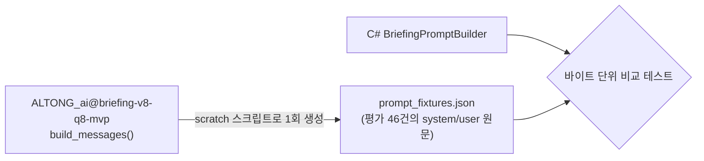

# 🛠️ Track 2 (Qwen 브리핑) 상용화 수정 계획

> ### 📌 현재 진행 상황 (2026-10-13 기준)
> - **1단계 (P0): 완료 (229/229 테스트 통과) ✅**
>   - `BriefingPromptBuilder.cs` 구현 및 38개 fixture 바이트 일치 테스트 통과
>   - `LlamaBriefingEngine.cs` ChatML 직접 조립 및 Greedy 디코딩(temp 0) 적용
>   - `App.xaml.cs` 대시보드 LLM 재추론 제거 (`summaryProvider: null`)
>   - 결정적 ID(SHA256) 생성 및 세션별 태스크 캐시 적용
> - **2단계 (P1 - 안정성): 다음 작업 대기 ⏳**
>   - 추론 완료 후 메모리 언로드, SemaphoreSlim(1) 직렬화, CPU 스레드 수 제한, 90초 타임아웃
> - **3단계 (P1 - 일정 추출기): 대기 ⏳**
>
> ⚠️ **노트북 이전 시 주의사항:**
> `models/briefing/qwen_briefing_v8_q8_0.gguf` 모델 파일은 `.gitignore` 대상이므로 Git으로 넘어가지 않습니다.  
> 노트북에서 `git pull` 후 `models/briefing/` 폴더에 모델 파일을 수동 복사하거나 GitHub Release(`briefing-v8-q8-mvp`)에서 다운로드해 넣어야 실 모델 테스트가 동작합니다.

## 목표
[검토 리포트](file:///C:/Users/kdjkd/.gemini/antigravity-ide/brain/ba8cbeb4-dcb4-4f3c-9cd7-08c7ad59d1f9/ai_integration_review.md)에서 찾은 P0·P1 이슈를 고칩니다. **각 단계는 따로 끝낼 수 있고**, 단계가 끝날 때마다 `dotnet build`와 `dotnet test`가 통과해야 다음으로 넘어갑니다.

| 단계 | 범위 | 상태 | 예상 작업량 |
| :--- | :--- | :---: | :--- |
| **1단계 (P0)** | 프롬프트를 학습 원본과 일치, 대시보드 재추론 제거, 결정적 ID | **완료 ✅** | 가장 큼, 효과도 가장 큼 |
| **2단계 (P1)** | 메모리 해제, 추론 직렬화, 스레드 수와 시간 제한, 엄격한 파싱 | **대기 ⏳** | 중간 |
| **3단계 (P1)** | 일정 추출기 버그 | **대기 ⏳** | 작음 |

**이번 범위에서 제외:** P2 항목(모델 다운로드·해시 확인, NOTICE 파일, 별도 프로세스 분리, KLUE INT8, 저사양 PC 측정)

---

## Open Questions

> [!IMPORTANT]
> **Q1. 대시보드에서 LLM 호출을 빼도 될까요?**
> AI 요약은 세션이 끝날 때 리포트 창에서 **한 번만** 만들고, 대시보드는 **저장된 요약만** 보여주는 방식을 제안합니다. 이렇게 하면 리포트를 저장하지 않고 닫은 세션은 대시보드에 AI 요약이 나오지 않습니다. 저장하지 않으면 리포트 자체가 남지 않는 기존 정책과 같은 동작입니다.

> [!NOTE]
> **Q2. 46건 결과 비교는 Python 출력 없이 시작합니다.** AI 팀 저장소의 `build_messages()`를 제가 직접 실행해서 **기대 프롬프트 fixture**를 만들고, C#이 만든 프롬프트가 그와 바이트 단위로 같은지 확인합니다. 모델 품질(카테고리 일치율)은 실제 모델로 46건을 돌려 측정하는 선택 실행 테스트로 확인합니다. 박민준 님의 Python 출력을 받으면 나중에 결과 비교로 강화하면 됩니다.

---

## 1단계 — P0

### 1-A. 프롬프트·템플릿을 학습 원본과 일치



#### [NEW] `Services/AI/Briefing/BriefingPromptBuilder.cs`
- `SYSTEM_PROMPT`의 규칙 1~15번과 `CATEGORY_GUIDE`를 원본 문자열 그대로 옮깁니다. Python의 `split("출력 스키마:")`와 12번 규칙 교체 로직도 그대로 재현합니다.
- 입력 JSON을 `{app_name, sender, notifications_oldest_to_newest:[{timestamp,title,body}]}` 구조로 만듭니다. 구분자는 `separators=(",",":")`, `ensure_ascii=False`와 같게 맞춥니다.
- `app_identity()`를 이식합니다(구현 시 `clustering.py`에서 확인).
- user 메시지 문구도 `category_prompt.build_messages`와 똑같이 맞춥니다.

#### [MODIFY] [LlamaBriefingEngine.cs](file:///c:/Users/kdjkd/Desktop/ALTONG_client/src/Altong.Client/Services/AI/Briefing/LlamaBriefingEngine.cs)
- `ChatSession`과 `InteractiveExecutor`를 빼고 **`StatelessExecutor`에 ChatML을 직접 조립**해서 넣습니다.
  ```text
  <|im_start|>system\n{system}<|im_end|>\n<|im_start|>user\n{user}<|im_end|>\n<|im_start|>assistant\n{생각 모드 접두어: 학습 스크립트 기준}
  ```
- Qwen3 생각 모드 처리(빈 `<think></think>`를 넣을지)는 `prepare_category_dataset.py` 또는 학습 스크립트의 `apply_chat_template` 인자를 보고 정합니다.
- `AntiPrompts = ["<|im_end|>"]`, 그리고 원본처럼 `MaxTokens = 256`으로 둡니다.
- 생성 결과가 바뀌지 않도록 **greedy 디코딩(temperature 0)**을 씁니다.

#### [NEW] `tests/.../Fixtures/briefing_prompt_fixtures.json` + `BriefingPromptParityTests.cs`
- scratch Python 스크립트(아티팩트 폴더의 `scratch/`, 저장소에는 넣지 않음)로 `evaluation_cases.jsonl` 46건의 프롬프트를 덤프합니다.
- C# 테스트에서 46건이 모두 같은지 확인합니다.

### 1-B. 대시보드 재추론 제거, 결정적 ID, 캐시

#### [MODIFY] [App.xaml.cs](file:///c:/Users/kdjkd/Desktop/ALTONG_client/src/Altong.Client/App.xaml.cs)
```diff
-                    RequestShutdown,
-                    summaryProvider: _reportSummaryProvider);
+                    RequestShutdown);   // 대시보드는 저장된 SummaryItems만 사용
```

#### [MODIFY] [LlamaReportSummaryProvider.cs](file:///c:/Users/kdjkd/Desktop/ALTONG_client/src/Altong.Client/Services/AI/Briefing/LlamaReportSummaryProvider.cs)
- **결정적 ID:** `SummaryId = "sum-" + sha256(sessionId|groupKey|정렬된 알림 ID)[..12]`, `EventId`도 같은 방식으로 만듭니다.
- **세션별 메모리 캐시:** `ConcurrentDictionary<sessionId, Task<ReportSummarySupply>>`로 같은 세션을 다시 추론하지 않습니다.

---

## 2단계 — P1 (안정성)

#### [MODIFY] `LlamaBriefingEngine.cs` / `LlamaReportSummaryProvider.cs`
| 이슈 | 변경 |
| :--- | :--- |
| 메모리 상주 | `ReadAsync`가 끝나면 `finally`에서 `engine.Unload()`를 호출해 가중치를 해제합니다 |
| 동시 실행 | 공급자 단위 `SemaphoreSlim(1)`로 세션 브리핑을 한 번에 하나만 실행합니다 |
| 해제 경합 | `Dispose()`는 세마포어를 얻은 다음, 즉 진행 중인 추론이 끝난 다음에 해제합니다 |
| CPU 점유 | `Threads = Max(1, ProcessorCount/2)`. 추론 스레드는 `BelowNormal` 우선순위 |
| 시간 제한 | 세션 전체에 90초 제한(linked CTS). 시간이 넘으면 남은 그룹은 폴백 처리 |
| 컨텍스트 | `ContextSize = 4096`. 그룹당 최근 알림 20건까지만 넣고, 프롬프트 토큰 수가 예산을 넘으면 오래된 알림부터 제거 |
| 엄격한 파싱 | Python `parse_response`와 똑같이 적용합니다. 키는 정확히 2개, 카테고리는 허용된 8개 값, 줄은 1~3개, 줄 길이 제한(`MAX_LINE_LENGTH`). 정규식으로 끌어모으던 복구 로직은 **삭제** |
| 폴백 표시 | 파싱에 실패하면 `"(AI 요약 실패) 발신자: 원문"`처럼 AI 결과가 아님을 표시 |

---

## 3단계 — 일정 추출기 ([BriefingScheduleExtractor.cs](file:///c:/Users/kdjkd/Desktop/ALTONG_client/src/Altong.Client/Services/AI/Briefing/BriefingScheduleExtractor.cs))

| 버그 | 수정 |
| :--- | :--- |
| PC 시간대가 KST가 아니면 예외 발생 | `DateTime.SpecifyKind(…, Unspecified)`로 바꾼 뒤 +09:00 적용. 기준 시각은 KST로 변환해서 사용 |
| "3시"를 03:00으로 처리 | `action_items.py`의 규칙을 그대로 따름(원본을 확인한 뒤 같은 동작으로) |
| 시간 범위에 오전/오후 미적용 | 범위 앞의 오전/오후를 시작·끝 시각 모두에 적용. 끝 시각이 시작보다 이르면 +12시간 |
| 연도 넘김 | 명시한 월·일이 기준 시각보다 60일 넘게 과거면 다음 해로 처리 |
| 원본과 다른 동작 | 원본 `test_category_briefing.py`의 일정 사례 중 핵심 몇 건을 C# 테스트로 이식 |

---

## Verification Plan

### Automated Tests
```shell
dotnet build
dotnet test                                                     # 기존 218개 + 새 테스트 전체 통과
dotnet test --filter "FullyQualifiedName~BriefingPromptParity"  # 프롬프트 46건 일치
dotnet test --filter "TestCategory=RealModel"                   # 선택 실행: 실제 모델로 46건 카테고리 일치율 출력
```
- 기존 `RealModelInference` 테스트는 **엄격한 파싱이 성공해야 통과**하도록 고칩니다. 지금처럼 폴백 결과로 통과하는 것은 막습니다.
- 1단계를 마치면 릴리즈 평가 수치(카테고리 교정 전 기준)와 크게 차이 나는지 비교해서 보고합니다.

### Manual Verification
- 집중 세션 종료 → 리포트 창에 AI 요약 표시 → 저장 → 대시보드를 열어도 **CPU 사용이 튀지 않고**, 숨김·저장 상태가 유지되는지 확인
- 브리핑 후 1~2분이 지나면 작업 관리자에서 메모리가 다시 내려가는지 확인
