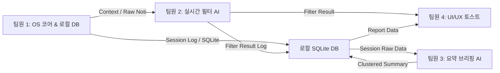

# 협업 규칙

## 브랜치와 병합

- `main`: 발표·제출 가능한 안정 버전. 직접 push하지 않는다.
- `develop`: 기능 통합 브랜치. 직접 push하지 않는다.
- 모든 변경은 `develop`에서 작업 브랜치를 만들고 PR로 `develop`에 병합한다. Windows CI가 성공해야 병합할 수 있다.
- 안정된 버전은 `develop`에서 `main`으로 PR을 만들어 반영한다.
- 병합 방식은 **Create a merge commit**이다. 병합된 작업 브랜치는 삭제하며 `main`과 `develop`은 유지한다.

작업 브랜치는 `<type>/<main-topic>`으로 이름 짓는다. 영문 소문자와 하이픈을 사용하고 작업 번호·담당자 이름은 넣지 않는다.

- type: `feature`, `fix`, `docs`, `refactor`, `test`, `chore`
- 예: `feature/focus-timer`, `fix/tray-exit`, `docs/readme`

## 커밋과 PR

커밋 제목은 영어로 `<type>: <subject>` 형식을 사용한다. type은 `feat`, `fix`, `docs`, `refactor`, `test`, `chore`다.

```text
feat: add focus session timer
fix: prevent duplicate tray icons
```

PR 제목은 `<type>: <한국어 제목>` 형식으로 작성한다. type은 커밋과 동일하게 `feat`, `fix`, `docs`, `refactor`, `test`, `chore`를 사용한다.

```text
feat: 집중 모드 타이머 추가
fix: 트레이 아이콘 중복 생성 문제 수정
docs: 협업 규칙 문서 추가
```

PR 본문은 한국어로 자유롭게 작성한다. 변경 내용, 확인 결과, 다른 모듈에 미치는 영향을 짧게 적는다. 공통 데이터 형태나 다른 모듈의 사용법을 변경할 때는 관련 팀원과 먼저 확인한다.

GitHub Issues, Issue Template, PR Template은 사용하지 않는다.

## 검증과 Windows CI

- 변경한 기능을 로컬에서 확인한다.
- CI가 구성된 뒤에는 PR 검사 결과도 확인한다.
- 확인하지 못한 내용이나 알려진 문제는 PR에 적는다.

Windows CI는 `.github/workflows/windows-ci.yml` 하나로 구성되어 있다.

실행 조건:

- `develop`에 push
- `develop` 또는 `main` 대상 PR 생성·갱신

검사 순서:

```text
Windows 실행 환경 준비 → .NET 환경 준비
→ C# 의존성 복원 → 정적 검사 → C# 테스트
→ 데스크톱 앱 테스트 빌드 → Fake AI를 사용한 연동 테스트
```

검사 도구와 명령은 앱 골격에 맞춰 확정한다. CI는 깨끗한 Windows 환경에서 C# 앱의 테스트·빌드와 Fake AI 기반 연동을 확인한다. Fake는 합의된 데이터 계약을 따르며, 실제 AI의 품질·성능 검증을 대신하지 않는다. 실제 알림 수집도 Fake로 대체하고, 트레이·말풍선·모니터별 UI는 로컬에서 확인한다. 빌드 성공만으로 모든 PC에서의 실행을 보장하지는 않는다.

`develop`에 PR이 병합되면 push 조건으로 CI가 다시 실행된다. 실패하면 로그를 확인해 수정한다.

---

## 👥 8. 5인 팀 업무 분장 (R&R) & 모듈 인터페이스

> 📦 원래 README §8에 있던 내용입니다. 담당자 이름별 액션 아이템은 [AI_MODELS.md](AI_MODELS.md)의 "팀원별 차주 액션 아이템"을 참고하세요.



| 담당자 | 포지션 & 역할 | 주요 개발 산출물 및 담당 태스크 |
| :--- | :--- | :--- |
| **팀원 1** | **클라이언트 시스템 엔지니어 (OS 코어 & 로컬 DB)** | • WinRT 기반 Windows 알림 수신 리스너 구축<br/>• Win32 기반 활성 창/프로세스 주기적 추적기 & 5초 룰 안정화<br/>• **로컬 SQLite DB 스키마 설계 및 데이터 액세스 레이어(Repository) 구축**<br/>• Windows 집중 지원(방해 금지) 상태 제어/가이드 모듈 |
| **팀원 2** | **AI 엔지니어 (데이터셋 & 실시간 필터링)** | • 알림-맥락 긴급도 데이터셋 수집, 증강 및 전처리<br/>• 경량 SLM(Qwen 2.5 0.5B/1.5B) LoRA 파인튜닝 및 양자화<br/>• 100% JSON 스키마 강제 파이프라인 및 벤치마크 평가 |
| **팀원 3** | **AI 엔지니어 (요약 및 브리핑)** | • 세션 차단 알림 임베딩 및 비지도 클러스터링 모듈<br/>• 클러스터별 3줄 요약 및 To-Do / 일정 추출 프롬프트<br/>• **창 추적 로그 + 알림 결합 마크다운 업무 일지(TIL) 자동 생성 파이프라인** |
| **팀원 4** | **데스크톱 UI/UX 개발자** | • 시스템 트레이 백그라운드 상주 앱 (WPF)<br/>• 다이내믹 포커스 HUD (화면 상단 반투명 캡슐 오버레이 & 방어 애니메이션)<br/>• 세련된 커스텀 토스트 알림 팝업 및 집중 타이머 UI |
| **팀원 5** | **풀스택 / 대시보드 (통합 PL)** | • 세션 종료 후 요약 리포트 대시보드 (스마트 답장, 캘린더 연동, **TIL 원클릭 복사**)<br/>• 5개 모듈 결합 E2E 테스트 및 최종 시연 시나리오 총괄 |
