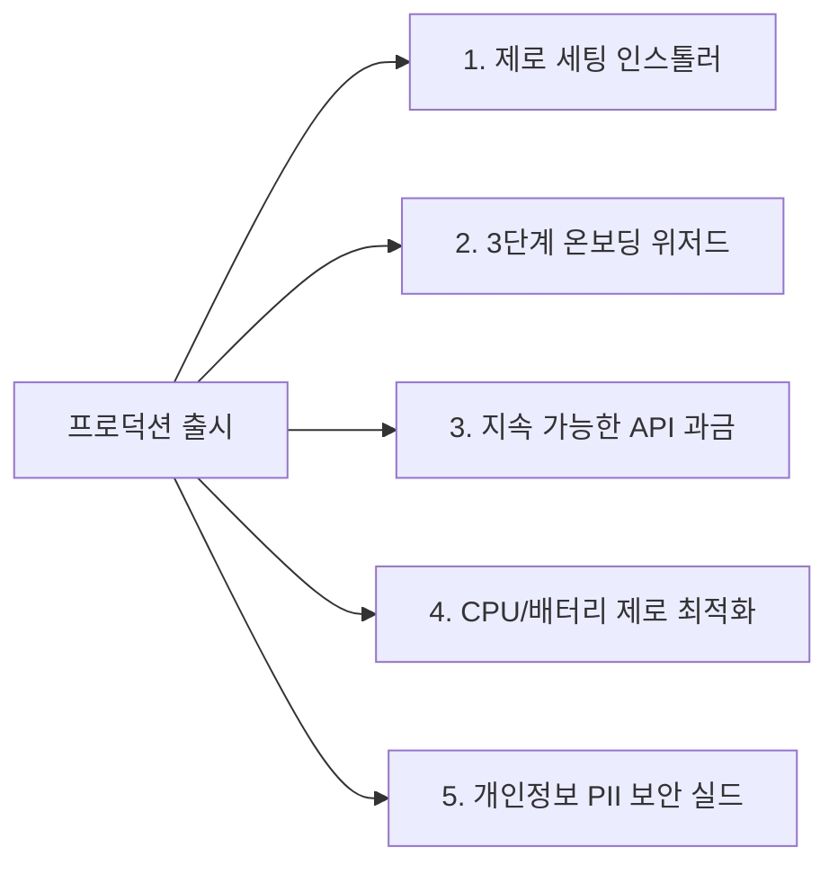

# 🗺️ ContextPass 로드맵

> 기능 아이디어 백로그와 정식 출시 계획을 모은 문서입니다.
> 원래 `docs/FEATURE_BACKLOG.md`와 `docs/RELEASE_SPEC.md`를 합쳤습니다.

## 0. 구현 현황 (develop `682e01e` 기준)

> [!NOTE]
> 아래 원문의 Python·PyQt6·`pyperclip`·`win32gui`·PyInstaller 예시는 초기 Python 프로토타입 기준입니다. 현재 앱은 C# .NET 9 WPF입니다.

### 0.1 기능 백로그

| 기능 | 상태 | 현재 구현 |
| :--- | :--- | :--- |
| 1. 스마트 답장 초안 | 일부 구현 | 리포트 창에서 답장 초안을 클립보드로 복사. 메신저 창 자동 포커스는 없음 |
| 2. 구글 캘린더 원클릭 등록 | 구현 | `GoogleCalendarLink` (Web Intent URL) |
| 3. 다이내믹 포커스 HUD | 형태 변경 | 화면 상단 캡슐 대신 작업표시줄 위 가로 미니바 + 알림 패널, 스텔스 미니바 |
| 4. TIL·업무 일지 자동 생성 | 미구현 | `window_sessions` 데이터만 쌓는 중. 대시보드에 시간대별 활동 일지 화면은 있음 |
| 5. 트레이 차단 카운터 배지 | 미구현 | 대신 미니바 캡슐에 긴급도 5 미확인 알림 개수 표시 |
| 6. 세션 종료 브리핑 대시보드 | 구현 (구성 다름) | `SessionReportWindow` + 대시보드(홈·알림 확인·활동 일지·캘린더·설정) |
| 7. 피드백 루프 | 미구현 | `user_feedbacks` 테이블만 있음 |
| 보류: 맥락 복귀 | 보류 | — |

### 0.2 출시 명세 과제

| 과제 | 상태 | 현재 구현 |
| :--- | :--- | :--- |
| 2.1 원클릭 인스톨러 | 미착수 | PyInstaller 계획은 폐기 대상. 현재 `packaging/sparse` + `tools/register-sparse-package.ps1` (알림 권한용 sparse package) |
| 2.2 온보딩 위저드 | 일부 | Windows 방해 금지 설정 안내 창(`WindowsDndGuidanceWindow`)만 있음 |
| 2.3 BYOK·클라우드 모드 | 미구현 | 완전 로컬 실행만 지원 |
| 2.4 이벤트 기반 창 추적 | 미구현 | `PeriodicTimer` 500ms 폴링 사용 |
| 2.5 PII 마스킹 | 미구현 | — |

---

## 💡 ContextPass 추가 기능 및 아이디어 백로그 (Feature Backlog)

> 📦 원래 `docs/FEATURE_BACKLOG.md`에 있던 내용입니다.
> **브레인스토밍을 통해 도출된 추가 기능 아이디어와 구현 방식을 지속적으로 기록하는 문서입니다.**

---

### 📌 [채택/확정] 주요 추가 기능 목록 (7건)

#### 1. 스마트 답장 초안 (Quick Reply Bridge)
* **목적:** 집중 세션 종료 후 알림을 확인했을 때, 사용자가 직접 타이핑할 필요 없이 1초 만에 답장할 수 있도록 보조.
* **동작 흐름:**
  1. 세션 요약 브리핑 카드의 `[답장: "네, 지금 확인했습니다"]` 버튼 클릭
  2. 시스템 클립보드에 해당 텍스트 자동 복사 (`pyperclip.copy()`)
  3. 해당 메신저 창(카카오톡, 슬랙 등)을 화면 맨 앞으로 자동 포커스 (`win32gui.SetForegroundWindow()`)
  4. 사용자는 메신저 창에서 **`Ctrl + V` 후 전송**만 누르면 완료
* **기술적 장점:**
  - 타사 메신저 API 권한이나 해킹성 매크로 없이 **OS 기본 기능(클립보드 + 윈도우 포커스)**만으로 안전하고 완벽하게 작동.
  - 보안/프라이버시 이슈 없이 시연 시 높은 완성도 연출 가능.

---

#### 2. 구글 캘린더 원클릭 등록 (Google Calendar Web Intent)
* **목적:** 알림 내용 중 일정/회의/약속 정보를 AI가 파악해 원클릭으로 캘린더에 바로 등록.
* **동작 흐름:**
  1. AI가 차단된 알림 본문에서 **일정 명칭, 날짜, 시간** 파싱
  2. 브리핑 카드에 `[📅 9/15(화) 15:00 팀 회의 캘린더 등록]` 버튼 생성
  3. 클릭 시 Google Calendar Web Intent URL을 웹 브라우저로 오픈:
     ```python
     # 예시: 복잡한 OAuth 연동 없이 브라우저로 1초 등록
     webbrowser.open("https://calendar.google.com/calendar/render?action=TEMPLATE&text=팀회의&dates=20260915T150000/20260915T160000")
     ```
* **기술적 장점:**
  - 무거운 Google OAuth2 API 인증 연동 없이 브라우저 템플릿 호출만으로 가볍고 직관적으로 동작.

#### 3. 다이내믹 포커스 HUD (Dynamic Focus Capsule HUD)
* **목적:** "눈에 보이지 않는 백그라운드 서비스"의 한계를 깨고, 세련되고 모던한 UI로 사용자가 실시간 집중 상태와 방어 현황을 직관적으로 체감하도록 지원.
* **디자인 및 UI 콘셉트 (Clean & Minimalist):**
  - **글래스모피즘 필(Pill) 캡슐:** 화면 상단 중앙(또는 우측 트레이 부근)에 부드럽게 떠 있는 반투명 미니멀 오버레이.
  - **평상시 (Focusing State):** 뽀모도로/집중 잔여 시간과 함께 은은한 숨쉬기 효과(Breathing Glow). 방해를 주지 않는 초소형 크기.
  - **방어 발생 시 (Shield Animation):** 잡담/광고 알림 차단 시 캡슐이 0.5초간 부드럽게 확장되며 `[🛡️ KakaoTalk 잡담 차단됨]` 아이콘과 문구가 떴다가 부드럽게 페이드아웃(Dissolve).
  - **호버/클릭 시:** 현재 세션에서 차단된 알림 개수(`차단 4건`) 미니 드롭다운 표시.
* **기술적 장점:**
  - `PyQt6`의 `FramelessWindowHint`와 `WA_TranslucentBackground`를 활용해 Windows 기본 창틀 없이 맥북의 다이내믹 아일랜드처럼 극도로 미려한 UI 구현 가능.
  - 시연 및 발표 시 데모 영상의 시각적 임팩트를 200% 극대화.

---

#### 4. 세션 종료 1초 전: GitHub TIL & 업무 일지(Work Log) 자동 생성 ⭐ [Killer Feature]
* **기획 배경:**
  - 개발자/학생/직장인이 매일 겪는 고통: *"오늘 하루 종일 바빴는데 정작 뭘 했는지 기억이 안 나고, 커밋이나 일지 쓰기 너무 귀찮다."*
  - ContextPass는 **`[사용자가 직접 한 작업(Active Window 추적 로그)]`**과 **`[외부에서 받은 자극(수신된 알림 데이터)]`**를 **동시에 보유한 유일한 서비스**임에 착안.
* **동작 원리:**
  1. 집중 세션 동안 기록된 활성 창 로그(예: `VS Code: auth_controller.py`, `Chrome: StackOverflow, GitHub PR`)와 수신된 주요 업무 알림들을 집계.
  2. 세션 종료(또는 퇴근) 시 AI가 이를 결합하여 **완성도 높은 마크다운(Markdown) 일일 개발/업무 일지**를 1초 만에 자동 생성.
* **출력 예시:**
  ```markdown
  # 📅 2026-09-13 (토) 개발 & 집중 세션 리포트
  - ⏱️ **총 몰입 시간:** 2시간 40분 (차단된 방해 알림: 8건 / 절약된 컨텍스트 스위칭 시간: 약 3시간)
  - 💻 **핵심 수행 작업:**
    - VS Code 백엔드 JWT 인증 모듈 구현 및 버그 수정 (`auth_controller.py`)
    - GitHub PR #42 코드 리뷰 피드백 반영
  - 💬 **주요 커뮤니케이션 & 완료 이슈:**
    - 팀 슬랙 서버 핫픽스 긴급 대응 완료
    - 과제 제출 일정(오늘 23:59) 확인 및 등록 완료
  ```
* **UI/UX:**
  - 브리핑 화면 하단에 **`[📋 마크다운 원클릭 복사]`** 및 **`[💾 .md 파일 저장]`** 제공.
  - 노션(Notion), 벨로그, 깃허브 잔디(TIL) 리포지토리에 바로 붙여넣기 가능.
* **심사위원 임팩트:**
  - 단순히 알림을 차단하고 끝나는 유틸리티를 넘어, **"하루의 시작부터 끝까지 생산성을 극대화하는 종합 엔지니어링 워크스페이스 어시스턴트"**로 제품의 격을 한 단계 끌어올림.

---

#### 5. 시스템 트레이 실시간 차단 카운터 배지 & 호버 툴팁 (Dynamic System Tray Badge)
* **목적:** 모니터 화면을 가리지 않고도 윈도우 우측 하단 작업 표시줄을 곁눈질하여 현재 방어 상태를 즉각 인지할 수 있는 초경량 UX 제공.
* **주요 기능:**
  - **동적 숫자 배지 (Dynamic Counter):** 잡담 알림이 차단될 때마다 트레이 아이콘 위에 빨간 원형 배지(`🛡️ 1` ➡️ `🛡️ 2` ➡️ `🛡️ 3`)가 실시간으로 갱신됨 (`QPainter` 렌더링).
  - **마우스 호버 툴팁 (Tooltip):** 마우스 오버 시 미니 풍선 도움말 표시:
    > `🛡️ ContextPass: 집중 세션 진행 중 (잔여 18분) | 차단된 알림 4건 (절약 시간 92분)`
  - **우클릭 컨텍스트 메뉴:** `[대시보드 열기]`, `[집중 세션 조기 종료]`, `[설정]` 메뉴 제공.

---

#### 6. 세션 종료 브리핑 대시보드 (Focus Debriefing Dashboard UI) ⭐ [Key UI]
* **목적:** 집중 세션이 종료되는 순간 자동으로 팝업되어, 몰입 성과(절약 시간)를 정량적으로 증명하고 차단된 알림들을 30초 만에 처리할 수 있도록 지원하는 메인 결과 화면.
* **UI 레이아웃 와이어프레임:**
  ```text
  ┌────────────────────────────────────────────────────────────────────────────────────────┐
  │  🧠 ContextPass  │  집중 세션 리포트                                       [ ─  □  ✕ ] │
  ├────────────────────────────────────────────────────────────────────────────────────────┤
  │  🎉 2시간 15분 동안 깊은 몰입(Flow)을 유지하셨습니다!                                      │
  │                                                                                        │
  │  ┌───────────────────────┐  ┌───────────────────────┐  ┌────────────────────────────┐  │
  │  │   ⏱️ 총 몰입 시간      │  │   🛡️ 방어된 방해 알림  │  │   💡 절약된 인지 스위칭    │  │
  │  │       2시간 15분       │  │          14 건            │  │     약 5.3시간 (322분)   │  │
  │  └───────────────────────┘  └───────────────────────┘  └────────────────────────────┘  │
  ├────────────────────────────────────────────────────────────────────────────────────────┤
  │  📂 부재 중 수신된 알림 지능형 요약 (3개 그룹)                                         │
  │                                                                                        │
  │  [ 🔥 업무 / 프로젝트 ] (3건)                                                          │
  │  • 김철수 팀장: 오늘 18시 배포 전 로그인 JWT 만료 버그 긴급 핫픽스 요청 건                │
  │    └─ [ 💬 AI 답장 초안 복사 후 카톡 열기: "네, 지금 바로 확인하겠습니다!" ]           │
  │                                                                                        │
  │  [ 📅 일정 / 데드라인 ] (2건)                                                          │
  │  • 캡스톤 단톡방: 내일(화) 15:00 종합강의동 302호 중간 점검 회의                          │
  │    └─ [ 📅 9/15(화) 15:00 구글 캘린더 원클릭 등록 ]                                    │
  │                                                                                        │
  │  [ ☕ 일상 / 잡담 ] (9건)                                                              │
  │  • 친구 단톡방 저녁 삼겹살 약속 및 쿠팡 로켓배송 도착 알림 (무음 처리 완료)             │
  ├────────────────────────────────────────────────────────────────────────────────────────┤
  │  📊 방해 타임라인                                                                      │
  │  14:00 ───[카톡]─── 14:30 ───[슬랙/깃허브 집중 발생]─── 15:30 ─── 16:15 [종료]         │
  ├────────────────────────────────────────────────────────────────────────────────────────┤
  │  [ 📝 오늘 작업 일지(TIL) 마크다운 복사 ]    [ 💾 리포트 파일 저장 ]      [ 확인 및 닫기 ]  │
  └────────────────────────────────────────────────────────────────────────────────────────┘
  ```
* **기술 구현:** WPF 카드 컴포넌트 및 차트 위젯 적용.

---

#### 7. 선별 기준 커스터마이징 & 사용자 피드백 루프 (Adaptive Feedback Loop) ⭐ [1주차 회의 확정]
* **기획 배경:**
  - 사용자마다 업무 환경, 직무, 성향에 따라 "긴급도"와 "연관도"를 느끼는 주관적 기준이 상이함.
  - 고정된 범용 모델만으로는 모든 사용자의 선호도를 완벽히 만족시킬 수 없으므로, 사용자의 실제 행동과 피드백을 학습해 진화하는 퍼스널라이징 시스템 필요.
* **동작 흐름:**
  1. **사후 검토:** 집중 세션 종료 후 대시보드 리포트 화면에서 차단/통과된 알림 목록 표출.
  2. **원클릭 평가:** 각 알림 카드 옆에 직관적인 피드백 버튼 제공:
     - `[👍 적절한 선별]` / `[👎 오분류 (놓쳐서 곤란했음)]` / `[⚡ 항상 긴급으로 분류]`
  3. **로컬 프로필 적재:** 피드백 데이터를 로컬 SQLite의 `UserPreferenceFeedback`에 축적.
  4. **지속적 반영 (Calibration):**
     - 향후 실시간 판별 시 사용자의 피드백 히스토리를 AI 프롬프트(Few-shot/In-context) 또는 특정 발신자/키워드 가중치 룰에 동적으로 반영하여 판별 정확도 지속 고도화.
* **기대 효과:**
  - 초기 온보딩의 복잡한 설정을 완전히 배제(Zero-Config)하면서도, 사용할수록 내 작업 패턴에 정확히 맞춰지는 진정한 의미의 '지능형 집중 비서' 구현.

---

### ⏳ [보류 및 추가 검토] 논의 중인 아이디어

* **맥락 복귀 (직전 작업 창 원클릭 복귀):**
  - 긴급 알림 확인 후 직전 작업 창(VS Code 등)으로 되돌아가는 기능.
  - *현재 상태:* 사용성 및 필요성 측면에서 실효성이 모호하여 보류 후 재검토.

---

### 📝 [아이디어 추가 공간]
*(앞으로 회의나 대화를 나누며 떠오르는 새로운 아이디어를 이곳에 이어서 기록합니다)*

---

## 🚀 ContextPass 정식 프로덕트 출시 명세서 (Production Release Spec)

> 📦 원래 `docs/RELEASE_SPEC.md`에 있던 내용입니다.
> **학부 과제(MVP)를 넘어 일반 사용자 대상의 실제 소프트웨어 제품(v1.0)으로 출시하기 위한 프로덕션 엔지니어링 명세서**

---

### 🎯 1. 출시 목표 및 배포 채널

* **배포 형태:** Windows 10 / 11 전용 단일 설치 프로그램 (`ContextPass_Setup_v1.0.exe`)
* **타깃 사용자:** 컨텍스트 스위칭으로 고통받는 개발자, 연구원, 대학생, 원격 근무 직장인
* **출시 채널:**
  - 🌐 GitHub Releases (오픈소스 바이너리 배포)
  - 📢 긱뉴스(GeekNews), 디스콰이엇(Disquiet) 제품 론칭
  - 🏆 대학 캡스톤/공모전 출품 및 Product Hunt 론칭

---

### 🛠️ 2. 프로덕션 출시를 위한 5대 필수 엔지니어링 과제



---

#### 2.1 [설치/배포] 제로 세팅 원클릭 인스톨러 (Zero-Setup Packaging)
* **목표:** Python이나 의존성 라이브러리가 없는 일반 PC에서도 더블 클릭 한 번으로 설치 완료.
* **구현 방식:**
  - **PyInstaller / Nuitka 빌드:** Python 런타임, PyQt6 라이브러리, SQLite 엔진을 단일 바이너리로 컴파일.
  - **Inno Setup 스크립트 구축:**
    - 표준 Windows 설치 마법사 UI (설치 경로 선택, 라이선스 동의)
    - 바탕화면 바로가기 및 시작 메뉴 등록
    - **"Windows 시작 시 자동 실행 (시작 프로그램 등록)"** 레지스트리 옵션 제공 (`HKCU\Software\Microsoft\Windows\CurrentVersion\Run`)

---

#### 2.2 [온보딩 UX] 최초 실행 3단계 권한 가이드 (Permission Wizard)
* **목표:** Windows의 '알림 접근 권한' 미허용으로 인한 사용자 이탈(Chun)을 방지.
* **구현 방식:**
  - 앱 첫 실행 시 모던한 3단계 온보딩 다이얼로그 노출:
    1. **Step 1 (알림 권한 허용):**  
       `[설정창 열기]` 버튼 클릭 시 파이썬이 Windows 알림 권한 설정창을 다이렉트로 호출:
       ```python
       import os
       os.system("start ms-settings:privacy-notifications")
       ```
    2. **Step 2 (집중 지원 모드 연동):**  
       세션 시작 시 방해 금지 모드가 자동으로 켜지도록 시스템 가이드 안내.
    3. **Step 3 (시뮬레이션 테스트):**  
       가상의 모의 알림 1개를 수신하여 커스텀 토스트 및 방어 HUD가 정상 작동하는지 사용자 확인 후 시작.

---

#### 2.3 [비용/비즈니스] 지속 가능한 LLM 과금 모델 (BYOK & Hybrid)
* **목표:** 대규모 사용자 유입 시 개발자에게 발생하는 API 토큰 비용 파산 방지.
* **구현 방식 (설정창에서 모드 선택 지원):**
  1. **완전 무료/오프라인 모드 (Free Tier):**
     - 최초 설치 시 경량 모델(Qwen 2.5 1.5B GGUF, 약 1.1GB)을 백그라운드 다운로드.
     - 외부 네트워크 통신 0회, 내 PC 연산만으로 평생 무료 사용.
  2. **초고품질 클라우드 모드 (BYOK - Bring Your Own Key):**
     - Raycast, Cursor의 정책을 벤치마킹하여, 사용자가 본인의 **Google AI Studio(Gemini) 또는 OpenAI API Key**를 직접 입력하게 지원.
     - 사용자는 무료 티어(Gemini 분당 15회 무료)를 통해 비용 없이 최고급 LLM 성능 향유.

---

#### 2.4 [성능/배터리] 이벤트 기반 OS 훅 전환 (Event-Driven Optimization)
* **목표:** 노트북 배터리 광탈 방지 및 백그라운드 상주 시 CPU 점유율 0.0% 달성.
* **구현 방식:**
  - ❌ **기존 프로토타입:** 1초마다 무한 반복문(`while True`)으로 활성 창 폴링 (CPU 지속 소모).
  - ⭕ **프로덕션 릴리즈:** Windows OS의 포그라운드 변경 이벤트(`SetWinEventHook` - `EVENT_SYSTEM_FOREGROUND`)를 C-types로 수신.
  - 사용자가 창을 전환하는 순간에만 OS가 시그널을 주므로, **한 창에서 작업 중일 때는 CPU 점유율이 0.0%로 완전 정지**.

---

#### 2.5 [보안/프라이버시] 민감 정보(OTP/금융) 자동 마스킹 (PII Sanitizer)
* **목표:** 금융 거래 내역, 2단계 인증(OTP) 번호, 개인정보가 LLM이나 로컬 DB에 평문으로 유출되는 사고 원천 차단.
* **구현 방식:**
  - AI 분석 파이프라인 진입 직전, **정규식(Regex) 기반 PII 마스킹 모듈** 통과:
    - **금융 계좌/카드:** `\d{3,6}[-\s]?\d{2,6}[-\s]?\d{3,6}` ➡️ `[계좌번호 마스킹]`
    - **인증번호/OTP:** `(?:인증번호|코드|OTP)[\s:]*([0-9]{4,6})` ➡️ `[인증번호 ******]`
    - **주민등록번호:** `\d{6}-[1-4]\d{6}` ➡️ `[주민번호 마스킹]`
  - 데이터베이스(SQLite) 저장 시 민감 본문 필드는 선택적 해시/암호화 적용.

---

### 📅 3. 단계별 출시 로드맵 (Release Roadmap)

```text
[Phase 1: 학부 MVP 개발] (현재 단계)
 ├── WinRT 알림 리스너 + 창 추적
 ├── 로컬 SLM 파인튜닝 & Pydantic 구조화
 ├── PyQt6 다이내믹 HUD & 대시보드
 └── 모의 시뮬레이터 기반 시연 준비 완료 (중간/기말 평가 A+ 확보)

[Phase 2: 프로덕션 안정화]
 ├── SetWinEventHook 이벤트 드리븐 전환 (CPU 0.0% 최적화)
 ├── 정규식 기반 PII 마스킹 모듈 삽입
 └── Settings 메뉴 내 BYOK (Gemini/OpenAI Key) 입력창 구현

[Phase 3: 패키징 & 정식 론칭]
 ├── PyInstaller + Inno Setup 단일 설치 파일(.exe) 빌드
 ├── 3단계 온보딩 위저드 탑재
 └── GitHub Release v1.0.0 배포 및 GeekNews 공개
```
